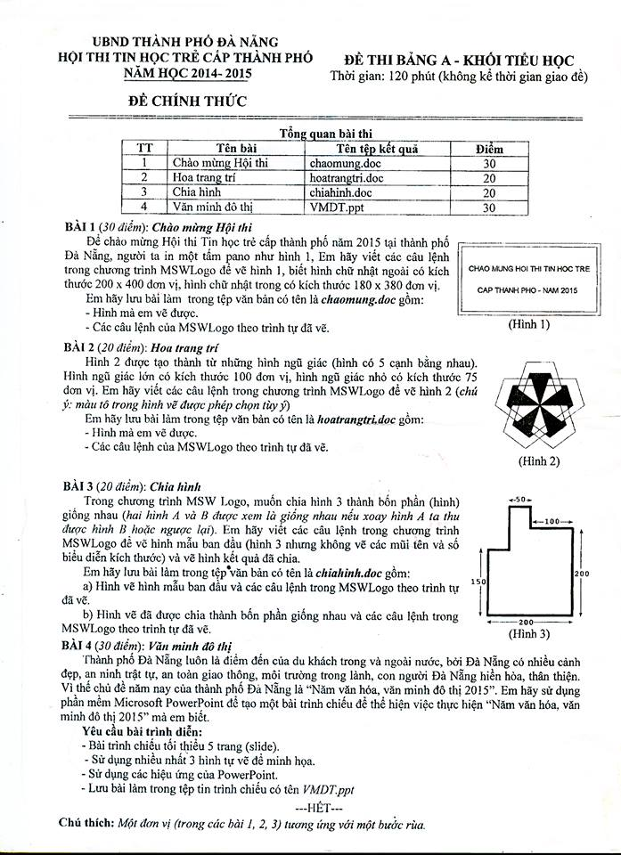

# Đề thi Bảng A - TP Đà Nẵng 2015

Hội thi Tin học trẻ cấp thành phố Đà Nẵng, năm học 2014–2015. **Đề chính thức** Bảng A - Khối Tiểu học. Thời gian làm bài: **120 phút** (không kể thời gian giao đề).

Bài thi thực hành ứng dụng: vẽ bằng **MSWLogo** và soạn bài trình chiếu bằng **Microsoft PowerPoint**.

**Chú thích của đề:** Một đơn vị (trong các bài 1, 2, 3) tương ứng với một bước rùa.

!!! warning "Nguồn đề"
    Đề được chép từ ảnh scan đề thi (`data/new_pdfs/DA NANG/TP ĐÀ NẴNG/ĐÀ NẴNG 2015.jpg`), đủ 1 trang, đọc rõ. Các hình mẫu (Hình 1, 2, 3) xem trong [bản scan](#de-goc-ban-scan).

## Tổng quan bài thi

| STT | Bài | Tên tệp kết quả | Điểm |
| ---: | --- | --- | ---: |
| 1 | Chào mừng Hội thi | `chaomung.doc` | 30 |
| 2 | Hoa trang trí | `hoatrangtri.doc` | 20 |
| 3 | Chia hình | `chiahinh.doc` | 20 |
| 4 | Văn minh đô thị | `VMDT.ppt` | 30 |

---

## 1. Chào mừng Hội thi

Để chào mừng Hội thi Tin học trẻ cấp thành phố năm 2015 tại thành phố Đà Nẵng, người ta in một tấm pano như hình 1. Em hãy viết các câu lệnh trong chương trình MSWLogo để vẽ hình 1, biết hình chữ nhật ngoài có kích thước 200 x 400 đơn vị, hình chữ nhật trong có kích thước 180 x 380 đơn vị.

Em hãy lưu bài làm trong tệp văn bản có tên là ***chaomung.doc*** gồm:

- Hình mà em vẽ được.
- Các câu lệnh của MSWLogo theo trình tự đã vẽ.

Hình 1 là hai hình chữ nhật lồng nhau, bên trong có hai dòng chữ "CHAO MUNG HOI THI TIN HOC TRE" và "CAP THANH PHO - NAM 2015". Xem Hình 1 trong [bản scan](#de-goc-ban-scan).

---

## 2. Hoa trang trí

Hình 2 được tạo thành từ những hình ngũ giác (hình có 5 cạnh bằng nhau). Hình ngũ giác lớn có kích thước 100 đơn vị, hình ngũ giác nhỏ có kích thước 75 đơn vị. Em hãy viết các câu lệnh trong chương trình MSWLogo để vẽ hình 2 (*chú ý: màu tô trong hình vẽ được phép chọn tùy ý*).

Em hãy lưu bài làm trong tệp văn bản có tên là ***hoatrangtri.doc*** gồm:

- Hình mà em vẽ được.
- Các câu lệnh của MSWLogo theo trình tự đã vẽ.

Xem Hình 2 trong [bản scan](#de-goc-ban-scan).

---

## 3. Chia hình

Trong chương trình MSW Logo, muốn chia hình 3 thành bốn phần (hình) giống nhau (*hai hình A và B được xem là giống nhau nếu xoay hình A ta thu được hình B hoặc ngược lại*). Em hãy viết các câu lệnh trong chương trình MSWLogo để vẽ hình mẫu ban đầu (hình 3 nhưng không vẽ các mũi tên và số biểu diễn kích thước) và vẽ hình kết quả đã chia.

Em hãy lưu bài làm trong tệp văn bản có tên là ***chiahinh.doc*** gồm:

a) Hình vẽ hình mẫu ban đầu và các câu lệnh trong MSWLogo theo trình tự đã vẽ.

b) Hình vẽ đã được chia thành bốn phần giống nhau và các câu lệnh trong MSWLogo theo trình tự đã vẽ.

Kích thước ghi trên Hình 3: cạnh đáy 200, cạnh phải 200, cạnh trái 150, phần nhô lên phía trên rộng 50, đoạn nằm ngang bên phải phần nhô rộng 100. Xem Hình 3 trong [bản scan](#de-goc-ban-scan).

!!! note "Cách hiểu đề dùng cho lời giải tham khảo"
    Hình 3 không ghi chiều cao phần nhô lên phía trên. Theo tỉ lệ trên hình vẽ, phần nhô là hình vuông $50 \times 50$, nằm ngay trên góc bị khuyết bên trái; khi đó hình 3 có diện tích $200 \times 200 = 40\,000$ (bằng hình vuông $200 \times 200$ bị khuyết một ô $50 \times 50$ ở góc trên trái và có thêm một ô $50 \times 50$ nhô lên). Gợi ý ở trang đáp án dùng cách hiểu này.

---

## 4. Văn minh đô thị

Thành phố Đà Nẵng luôn là điểm đến của du khách trong và ngoài nước, bởi Đà Nẵng có nhiều cảnh đẹp, an ninh trật tự, an toàn giao thông, môi trường trong lành, con người Đà Nẵng hiền hòa, thân thiện. Vì thế chủ đề năm nay của thành phố Đà Nẵng là "Năm văn hóa, văn minh đô thị 2015". Em hãy sử dụng phần mềm Microsoft PowerPoint để tạo một bài trình chiếu để thể hiện việc thực hiện "Năm văn hóa, văn minh đô thị 2015" mà em biết.

**Yêu cầu bài trình diễn:**

- Bài trình chiếu tối thiểu 5 trang (slide).
- Sử dụng nhiều nhất 3 hình tự vẽ để minh họa.
- Sử dụng các hiệu ứng của PowerPoint.
- Lưu bài làm trong tệp tin trình chiếu có tên ***VMDT.ppt***

---

!!! tip "Đáp án"
    Tự làm trước, sau đó xem [gợi ý hướng làm](dap-an.md).

## Đề gốc (bản scan) {#de-goc-ban-scan}

