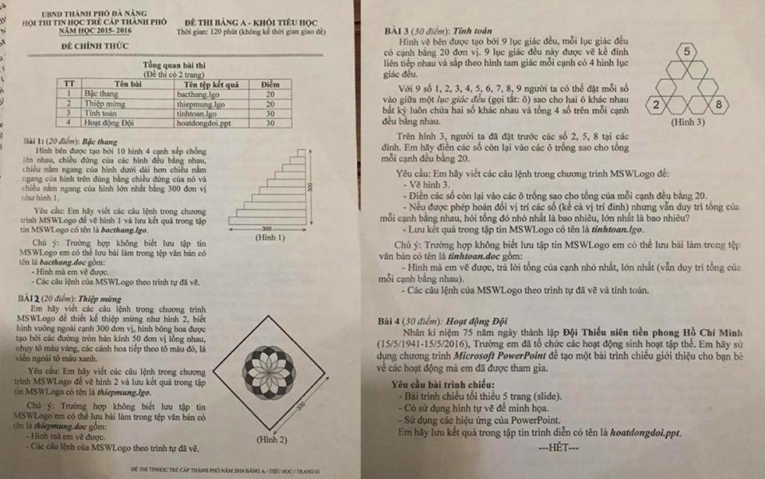

# Đề thi Bảng A - TP Đà Nẵng 2016

Hội thi Tin học trẻ cấp thành phố Đà Nẵng, năm học 2015–2016. **Đề chính thức** Bảng A - Khối Tiểu học, đề thi có 2 trang. Thời gian làm bài: **120 phút** (không kể thời gian giao đề).

Bài thi thực hành ứng dụng: vẽ và tính toán bằng **MSWLogo**, soạn bài trình chiếu bằng **Microsoft PowerPoint**.

!!! warning "Nguồn đề"
    Đề được chép từ ảnh chụp đề thi (`data/new_pdfs/DA NANG/TP ĐÀ NẴNG/ĐÀ NẴNG 2016.jpg`), một ảnh chụp cả 2 trang, đọc rõ. Trên bản chụp, số "2" trong tiêu đề "BÀI 2" được viết tay; nội dung đề không có chỗ sửa nào khác. Các hình mẫu (Hình 1, 2, 3) xem trong [bản scan](#de-goc-ban-scan).

## Tổng quan bài thi

| STT | Bài | Tên tệp kết quả | Điểm |
| ---: | --- | --- | ---: |
| 1 | Bậc thang | `bacthang.lgo` | 20 |
| 2 | Thiệp mừng | `thiepmung.lgo` | 20 |
| 3 | Tính toán | `tinhtoan.lgo` | 30 |
| 4 | Hoạt động Đội | `hoatdongdoi.ppt` | 30 |

---

## 1. Bậc thang

Hình bên được tạo bởi 10 hình 4 cạnh xếp chồng lên nhau, chiều đứng của các hình đều bằng nhau, chiều nằm ngang của hình dưới dài hơn chiều nằm ngang của hình trên đúng bằng chiều đứng của nó và chiều nằm ngang của hình lớn nhất bằng 300 đơn vị như hình 1.

Yêu cầu: Em hãy viết các câu lệnh trong chương trình MSWLogo để vẽ hình 1 và lưu kết quả trong tập tin MSWLogo có tên là ***bacthang.lgo***.

Chú ý: Trường hợp không biết lưu tập tin MSWLogo em có thể lưu bài làm trong tệp văn bản có tên là ***bacthang.doc*** gồm:

- Hình mà em vẽ được.
- Các câu lệnh của MSWLogo theo trình tự đã vẽ.

Trên Hình 1 ghi chiều ngang 300 và chiều cao cả hình 300; các bậc thẳng hàng ở mép phải. Xem Hình 1 trong [bản scan](#de-goc-ban-scan).

---

## 2. Thiệp mừng

Em hãy viết các câu lệnh trong chương trình MSWLogo để thiết kế thiệp mừng như hình 2, biết hình vuông ngoài cạnh 300 đơn vị, hình bông hoa được tạo bởi các đường tròn bán kính 50 đơn vị lồng nhau, nhụy tô màu vàng, các cánh hoa tiếp theo tô màu đỏ, lá viền ngoài tô màu xanh.

Yêu cầu: Em hãy viết các câu lệnh trong chương trình MSWLogo để vẽ hình 2 và lưu kết quả trong tập tin MSWLogo có tên là ***thiepmung.lgo***.

Chú ý: Trường hợp không biết lưu tập tin MSWLogo em có thể lưu bài làm trong tệp văn bản có tên là ***thiepmung.doc*** gồm:

- Hình mà em vẽ được.
- Các câu lệnh của MSWLogo theo trình tự đã vẽ.

Trên Hình 2, hình vuông được đặt nghiêng (dạng hình thoi), bông hoa nằm ở giữa. Xem Hình 2 trong [bản scan](#de-goc-ban-scan).

---

## 3. Tính toán

Hình vẽ bên được tạo bởi 9 lục giác đều, mỗi lục giác đều có cạnh bằng 20 đơn vị. 9 lục giác đều này được vẽ kề đỉnh liên tiếp nhau và sắp theo hình tam giác mỗi cạnh có 4 hình lục giác đều.

Với 9 số 1, 2, 3, 4, 5, 6, 7, 8, 9 người ta có thể đặt mỗi số vào giữa một *lục giác đều* (gọi tắt: ô) sao cho hai ô khác nhau bất kỳ luôn chứa hai số khác nhau và tổng 4 số trên mỗi cạnh đều bằng nhau.

Trên hình 3, người ta đã đặt trước các số 2, 5, 8 tại các đỉnh. Em hãy điền các số còn lại vào các ô trống sao cho tổng mỗi cạnh đều bằng 20.

Yêu cầu: Em hãy viết các câu lệnh trong chương trình MSWLogo để:

- Vẽ hình 3.
- Điền các số còn lại vào các ô trống sao cho tổng của mỗi cạnh đều bằng 20.
- Nếu được phép hoán đổi vị trí các số (kể cả vị trí đỉnh) nhưng vẫn duy trì tổng của mỗi cạnh bằng nhau, hỏi tổng đó nhỏ nhất là bao nhiêu, lớn nhất là bao nhiêu?
- Lưu kết quả trong tập tin MSWLogo có tên là ***tinhtoan.lgo***.

Chú ý: Trường hợp không biết lưu tập tin MSWLogo em có thể lưu bài làm trong tệp văn bản có tên là ***tinhtoan.doc*** gồm:

- Hình mà em vẽ được, trả lời tổng của cạnh nhỏ nhất, lớn nhất (vẫn duy trì tổng của mỗi cạnh bằng nhau).
- Các câu lệnh của MSWLogo theo trình tự đã vẽ và tính toán.

Trên Hình 3: số 5 ở ô đỉnh trên, số 2 ở ô đỉnh dưới bên trái, số 8 ở ô đỉnh dưới bên phải. Xem Hình 3 trong [bản scan](#de-goc-ban-scan).

---

## 4. Hoạt động Đội

Nhân kỉ niệm 75 năm ngày thành lập **Đội Thiếu niên tiền phong Hồ Chí Minh** (15/5/1941-15/5/2016), Trường em đã tổ chức các hoạt động sinh hoạt tập thể. Em hãy sử dụng chương trình ***Microsoft PowerPoint*** để tạo một bài trình chiếu giới thiệu cho bạn bè về các hoạt động mà em đã được tham gia.

**Yêu cầu bài trình chiếu:**

- Bài trình chiếu tối thiểu 5 trang (slide).
- Có sử dụng hình tự vẽ để minh họa.
- Sử dụng các hiệu ứng của PowerPoint.

Em hãy lưu kết quả trong tập tin trình diễn có tên là ***hoatdongdoi.ppt***.

---

!!! tip "Đáp án"
    Tự làm trước, sau đó xem [gợi ý hướng làm](dap-an.md).

## Đề gốc (bản scan) {#de-goc-ban-scan}

