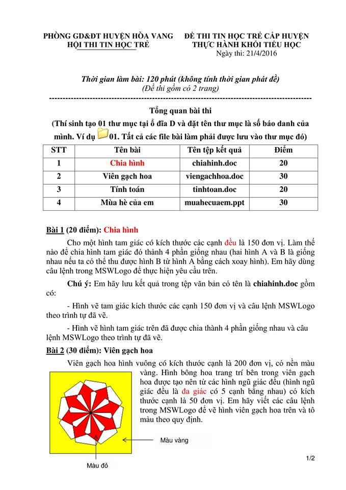

# Đề thi Bảng A - Huyện Hòa Vang 2016

Hội thi Tin học trẻ cấp huyện, Phòng GD&ĐT huyện Hòa Vang (TP. Đà Nẵng), đề thi thực hành khối Tiểu học. Ngày thi: **21/4/2016**. Thời gian làm bài: **120 phút** (không tính thời gian phát đề). Đề thi gồm 2 trang.

Thí sinh tạo 01 thư mục tại ổ đĩa D và đặt tên thư mục là số báo danh của mình (ví dụ `01`). Tất cả các file bài làm phải được lưu vào thư mục đó.

!!! warning "Nguồn đề"
    Đề được chép từ ảnh chụp đề thi *HÒA VANG/HÒA VANG 2016.jpg* (bộ đề Đà Nẵng). Ảnh chỉ có **trang 1/2**: Bài 1 và Bài 2 có đề đầy đủ; Bài 3 và Bài 4 chỉ biết tên bài, tên tệp kết quả và điểm (từ bảng tổng quan), không có nội dung đề.

## Tổng quan bài thi

| STT | Bài | Tên tệp kết quả | Điểm |
| ---: | --- | --- | ---: |
| 1 | Chia hình | `chiahinh.doc` | 20 |
| 2 | Viên gạch hoa | `viengachhoa.doc` | 30 |
| 3 | Tính toán | `tinhtoan.doc` | 20 |
| 4 | Mùa hè của em | `muahecuaem.ppt` | 30 |

---

## 1. Chia hình

Cho một hình tam giác có kích thước các cạnh **đều** là 150 đơn vị. Làm thế nào để chia hình tam giác đó thành 4 phần giống nhau (hai hình A và B là giống nhau nếu ta có thể thu được hình B từ hình A bằng cách xoay hình). Em hãy dùng câu lệnh trong MSWLogo để thực hiện yêu cầu trên.

**Chú ý:** Em hãy lưu kết quả trong tệp văn bản có tên là `chiahinh.doc` gồm có:

- Hình vẽ tam giác kích thước các cạnh 150 đơn vị và câu lệnh MSWLogo theo trình tự đã vẽ.
- Hình vẽ hình tam giác trên đã được chia thành 4 phần giống nhau và câu lệnh MSWLogo theo trình tự đã vẽ.

---

## 2. Viên gạch hoa

Viên gạch hoa hình vuông có kích thước cạnh là 200 đơn vị, có nền màu vàng. Hình bông hoa trang trí bên trong viên gạch hoa được tạo nên từ các hình ngũ giác đều (hình ngũ giác đều là **đa giác** có 5 cạnh bằng nhau) có kích thước cạnh là 50 đơn vị. Em hãy viết các câu lệnh trong MSWLogo để vẽ hình viên gạch hoa trên và tô màu theo quy định.

Xem hình viên gạch hoa (nền vàng, bông hoa có các phần tô màu đỏ) trong [bản scan](#de-goc-ban-scan).

---

## 3. Tính toán

!!! info "Thiếu đề chi tiết"
    Ảnh chụp chỉ có trang 1/2 của đề, nên chỉ biết tên bài (*Tính toán*), tên tệp kết quả `tinhtoan.doc` và điểm (20). Chưa thể viết đề đầy đủ hay lời giải. Nếu bạn có trang 2 của đề gốc, hãy gửi qua issue trên GitHub.

---

## 4. Mùa hè của em

!!! info "Thiếu đề chi tiết"
    Ảnh chụp chỉ có trang 1/2 của đề, nên chỉ biết tên bài (*Mùa hè của em*), tên tệp kết quả `muahecuaem.ppt` (bài trình chiếu PowerPoint) và điểm (30). Chưa thể viết đề đầy đủ. Nếu bạn có trang 2 của đề gốc, hãy gửi qua issue trên GitHub.

---

## Đề gốc (bản scan) { #de-goc-ban-scan }

---

!!! tip "Đáp án"
    Tự làm trước, sau đó xem [gợi ý hướng làm](dap-an.md).
