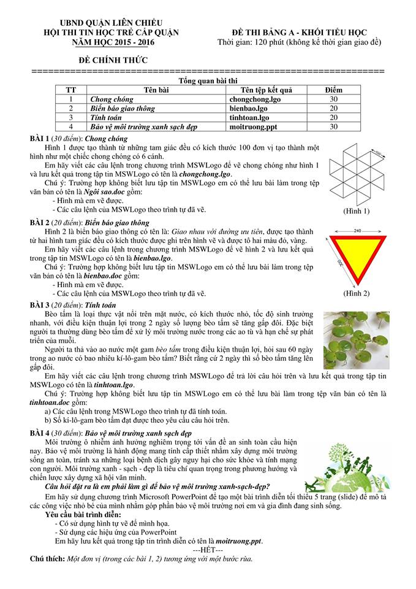

# Đề thi Bảng A - Quận Liên Chiểu 2016

Hội thi Tin học trẻ cấp quận, UBND quận Liên Chiểu (TP. Đà Nẵng), năm học 2015–2016. **Đề chính thức**, Bảng A - Khối Tiểu học. Thời gian: **120 phút** (không kể thời gian giao đề).

**Chú thích của đề:** Một đơn vị (trong các bài 1, 2) tương ứng với một bước rùa.

!!! warning "Nguồn đề"
    Đề được chép từ ảnh chụp đề thi *LIÊN CHIỂU/LIÊN CHIỂU 2016.jpg* (bộ đề Đà Nẵng), đủ 4 bài. Đề không ghi ngày thi. Đây là đề thực hành ứng dụng (MSWLogo, PowerPoint), không có bài lập trình giải thuật nên không có lời giải Python. Hình mẫu của Bài 1 và Bài 2 xem trong [bản scan](#de-goc-ban-scan).

## Tổng quan bài thi

| STT | Bài | Tên tệp kết quả | Điểm |
| ---: | --- | --- | ---: |
| 1 | Chong chóng | `chongchong.lgo` | 30 |
| 2 | Biển báo giao thông | `bienbao.lgo` | 20 |
| 3 | Tính toán | `tinhtoan.lgo` | 20 |
| 4 | Bảo vệ môi trường xanh sạch đẹp | `moitruong.ppt` | 30 |

---

## 1. Chong chóng

Hình 1 được tạo thành từ những tam giác đều có kích thước 100 đơn vị tạo thành một hình như một chiếc chong chóng có 6 cánh.

Em hãy viết các câu lệnh trong chương trình MSWLogo để vẽ chong chóng như hình 1 và lưu kết quả trong tập tin MSWLogo có tên là *chongchong.lgo*.

Chú ý: Trường hợp không biết lưu tập tin MSWLogo em có thể lưu bài làm trong tệp văn bản có tên là *Ngôi sao.doc* gồm:

- Hình mà em vẽ được.
- Các câu lệnh của MSWLogo theo trình tự đã vẽ.

Xem hình 1 trong [bản scan](#de-goc-ban-scan).

!!! note "Ghi chú về đề gốc"
    Đề gốc ghi tên tệp văn bản dự phòng của bài này là *Ngôi sao.doc* (khác tên bài *Chong chóng*); trang này chép nguyên văn.

---

## 2. Biển báo giao thông

Hình 2 là biển báo giao thông có tên là: *Giao nhau với đường ưu tiên*, được tạo thành từ hai hình tam giác đều có kích thước được ghi trên hình vẽ và được tô hai màu đỏ, vàng.

Em hãy viết các câu lệnh trong chương trình MSWLogo để vẽ hình 2 và lưu kết quả trong tập tin MSWLogo có tên là *bienbao.lgo*.

Chú ý: Trường hợp không biết lưu tập tin MSWLogo em có thể lưu bài làm trong tệp văn bản có tên là *bienbao.doc* gồm:

- Hình mà em vẽ được.
- Các câu lệnh của MSWLogo theo trình tự đã vẽ.

Hình 2 (xem [bản scan](#de-goc-ban-scan)): tam giác đều lộn ngược (một đỉnh hướng xuống), viền ngoài màu đỏ, bên trong là tam giác đều màu vàng. Hai kích thước ghi trên hình là 240 (cạnh trên, đo phía trên hình) và 300 (cạnh bên).

!!! note "Cách hiểu đề dùng cho gợi ý"
    Hình không ghi rõ con số nào thuộc tam giác nào. Vì tam giác vàng nằm bên trong, gợi ý ở trang đáp án hiểu là tam giác ngoài (đỏ) có cạnh 300 và tam giác trong (vàng) có cạnh 240.

---

## 3. Tính toán

Bèo tấm là loại thực vật nổi trên mặt nước, có kích thước nhỏ, tốc độ sinh trưởng nhanh, với điều kiện thuận lợi trong 2 ngày số lượng bèo tấm sẽ tăng gấp đôi. Đặc biệt người ta thường dùng bèo tấm để xử lý môi trường nước trong các ao tù và hạn chế sự phát triển của muỗi.

Người ta thả vào ao nước một gam *bèo tấm* trong điều kiện thuận lợi, hỏi sau 60 ngày trong ao nước có bao nhiêu kí-lô-gam bèo tấm? Biết rằng cứ 2 ngày thì số bèo tấm tăng lên gấp đôi.

Em hãy viết các câu lệnh trong chương trình MSWLogo để trả lời câu hỏi trên và lưu kết quả trong tập tin MSWLogo có tên là *tinhtoan.lgo*.

Chú ý: Trường hợp không biết lưu tập tin MSWLogo em có thể lưu bài làm trong tệp văn bản có tên là *tinhtoan.doc* gồm:

a) Các câu lệnh trong MSWLogo theo trình tự đã tính toán.

b) Số kí-lô-gam bèo tấm đạt được theo yêu cầu câu hỏi trên.

---

## 4. Bảo vệ môi trường xanh sạch đẹp

Môi trường ô nhiễm ảnh hưởng nghiêm trọng tới vấn đề an sinh toàn cầu hiện nay. Bảo vệ môi trường là hành động mang tính cấp thiết nhằm xây dựng môi trường sống an toàn, tránh xa những loại bệnh dịch gây nguy hại cho sức khỏe và tính mạng con người. Môi trường xanh - sạch - đẹp là tiêu chí quan trọng trong phương hướng và chiến lược xây dựng xã hội văn minh.

***Câu hỏi đặt ra là em phải làm gì để bảo vệ môi trường xanh-sạch-đẹp?***

Em hãy sử dụng chương trình Microsoft PowerPoint để tạo một bài trình diễn tối thiểu 5 trang (slide) để mô tả các công việc nhỏ bé của mình nhằm góp phần bảo vệ môi trường nơi em và gia đình đang sinh sống.

**Yêu cầu bài trình diễn:**

- Có sử dụng hình tự vẽ để minh họa.
- Sử dụng các hiệu ứng của PowerPoint

Em hãy lưu kết quả trong tập tin trình diễn có tên là *moitruong.ppt*.

---

## Đề gốc (bản scan) { #de-goc-ban-scan }

---

!!! tip "Đáp án"
    Tự làm trước, sau đó xem [gợi ý hướng làm](dap-an.md).
