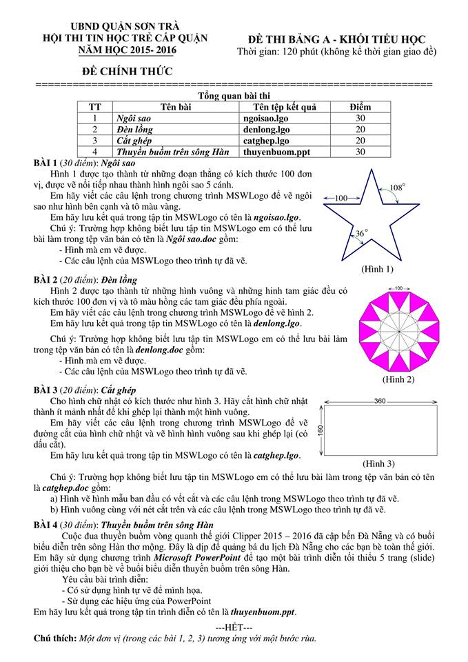

# Đề thi Bảng A - Quận Sơn Trà 2016

Hội thi Tin học trẻ cấp quận, UBND quận Sơn Trà, năm học 2015–2016. Đề thi Bảng A - Khối Tiểu học (đề chính thức). Thời gian: **120 phút** (không kể thời gian giao đề).

Phần mềm sử dụng: **MSWLogo** (lưu tệp `.lgo`, hoặc tệp văn bản `.doc` nếu không biết lưu tệp MSWLogo) và **Microsoft PowerPoint**.

!!! warning "Nguồn đề"
    Đề được chép từ ảnh chụp đề thi (`DA NANG/SƠN TRÀ/QUẬN SƠN TRÀ 2016.jpg`). Ảnh không ghi ngày thi. Đây là đề thực hành ứng dụng (vẽ MSWLogo, trình chiếu), không có bài lập trình giải thuật nên không có lời giải Python. Hình 1, Hình 2, Hình 3 xem trong [bản scan](#de-goc-ban-scan).

## Tổng quan bài thi

| TT | Tên bài | Tên tệp kết quả | Điểm |
| ---: | --- | --- | ---: |
| 1 | Ngôi sao | `ngoisao.lgo` | 30 |
| 2 | Đèn lồng | `denlong.lgo` | 20 |
| 3 | Cắt ghép | `catghep.lgo` | 20 |
| 4 | Thuyền buồm trên sông Hàn | `thuyenbuom.ppt` | 30 |

*Chú thích: Một đơn vị (trong các bài 1, 2, 3) tương ứng với một bước rùa.*

---

## 1. Ngôi sao

Hình 1 được tạo thành từ những đoạn thẳng có kích thước 100 đơn vị, được vẽ nối tiếp nhau thành hình ngôi sao 5 cánh.

Em hãy viết các câu lệnh trong chương trình MSWLogo để vẽ ngôi sao như hình bên cạnh và tô màu vàng.

Em hãy lưu kết quả trong tập tin MSWLogo có tên là **ngoisao.lgo**.

Chú ý: Trường hợp không biết lưu tập tin MSWLogo em có thể lưu bài làm trong tệp văn bản có tên là **Ngôi sao.doc** gồm:

* Hình mà em vẽ được.
* Các câu lệnh của MSWLogo theo trình tự đã vẽ.

Hình 1 (xem [bản scan](#de-goc-ban-scan)): ngôi sao 5 cánh, mỗi đoạn thẳng trên đường viền dài 100; góc ở đỉnh cánh sao là $36^\circ$, góc ghi trên hình ở chỗ lõm giữa hai cánh là $108^\circ$.

---

## 2. Đèn lồng

Hình 2 được tạo thành từ những hình vuông và những hình tam giác đều có kích thước 100 đơn vị và tô màu hồng các tam giác đều phía ngoài.

Em hãy viết các câu lệnh trong chương trình MSWLogo để vẽ hình 2.

Em hãy lưu kết quả trong tập tin MSWLogo có tên là **denlong.lgo**.

Chú ý: Trường hợp không biết lưu tập tin MSWLogo em có thể lưu bài làm trong tệp văn bản có tên là **denlong.doc** gồm:

* Hình mà em vẽ được.
* Các câu lệnh của MSWLogo theo trình tự đã vẽ.

Xem Hình 2 trong [bản scan](#de-goc-ban-scan).

---

## 3. Cắt ghép

Cho hình chữ nhật có kích thước như hình 3. Hãy cắt hình chữ nhật thành ít mảnh nhất để khi ghép lại thành một hình vuông.

Em hãy viết các câu lệnh trong chương trình MSWLogo để vẽ đường cắt của hình chữ nhật và vẽ hình hình vuông sau khi ghép lại (có dấu cắt).

Em hãy lưu kết quả trong tập tin MSWLogo có tên là **catghep.lgo**.

Chú ý: Trường hợp không biết lưu tập tin MSWLogo em có thể lưu bài làm trong tệp văn bản có tên là **catghep.doc** gồm:

a) Hình vẽ hình mẫu ban đầu có vết cắt và các câu lệnh trong MSWLogo theo trình tự đã vẽ.

b) Hình vuông cùng với nét cắt trên và các câu lệnh trong MSWLogo theo trình tự đã vẽ.

Hình 3: hình chữ nhật có chiều dài 360 và chiều rộng 160.

---

## 4. Thuyền buồm trên sông Hàn

Cuộc đua thuyền buồm vòng quanh thế giới Clipper 2015 – 2016 đã cập bến Đà Nẵng và có buổi biểu diễn trên sông Hàn thơ mộng. Đây là dịp để quảng bá du lịch Đà Nẵng cho các bạn bè toàn thế giới. Em hãy sử dụng chương trình **Microsoft PowerPoint** để tạo một bài trình diễn tối thiểu 5 trang (slide) giới thiệu cho bạn bè về buổi biểu diễn thuyền buồm trên sông Hàn.

Yêu cầu bài trình diễn:

* Có sử dụng hình tự vẽ để minh họa.
* Sử dụng các hiệu ứng của PowerPoint.

Em hãy lưu kết quả trong tập tin trình diễn có tên là **thuyenbuom.ppt**.

---

## Đề gốc (bản scan) { #de-goc-ban-scan }

---

!!! tip "Đáp án"
    Tự làm trước, sau đó xem [gợi ý hướng làm](dap-an.md).
