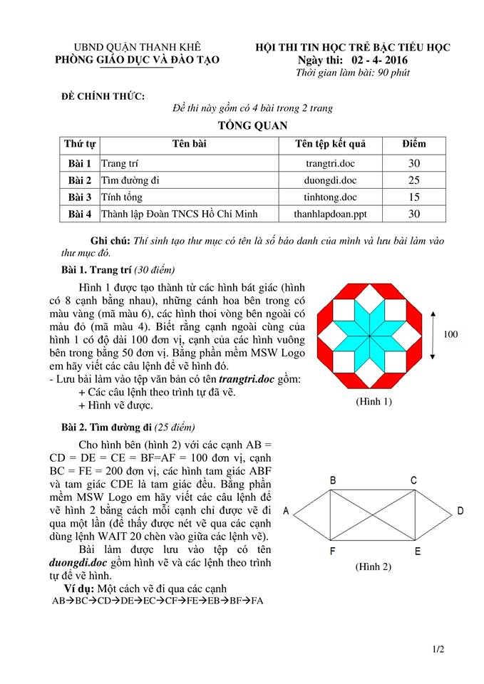

# Đề thi Bảng A - Quận Thanh Khê 2016

Hội thi Tin học trẻ bậc Tiểu học, Phòng Giáo dục và Đào tạo quận Thanh Khê (TP. Đà Nẵng). Ngày thi: **02/04/2016**. Thời gian làm bài: **90 phút**. Đề chính thức gồm 4 bài trong 2 trang.

Bài thi thực hành ứng dụng: vẽ và lập trình bằng **MSWLogo**, soạn bài trình chiếu bằng **Microsoft PowerPoint**.

**Ghi chú:** Thí sinh tạo thư mục có tên là số báo danh của mình và lưu bài làm vào thư mục đó.

!!! warning "Nguồn đề"
    Đề được chép từ ảnh chụp đề thi (`data/new_pdfs/DA NANG/THANH KHÊ/THANH KHÊ 2016 (1).jpg` và `(2).jpg`), đủ 2 trang. Hình 1 và Hình 2 xem trong [bản scan](#de-goc-ban-scan).

## Tổng quan bài thi

| STT | Bài | Tên tệp kết quả | Điểm |
| ---: | --- | --- | ---: |
| 1 | Trang trí | `trangtri.doc` | 30 |
| 2 | Tìm đường đi | `duongdi.doc` | 25 |
| 3 | Tính tổng | `tinhtong.doc` | 15 |
| 4 | Thành lập Đoàn TNCS Hồ Chí Minh | `thanhlapdoan.ppt` | 30 |

---

## 1. Trang trí

*(30 điểm)*

Hình 1 được tạo thành từ các hình bát giác (hình có 8 cạnh bằng nhau), những cánh hoa bên trong có màu vàng (mã màu 6), các hình thoi vòng bên ngoài có màu đỏ (mã màu 4). Biết rằng cạnh ngoài cùng của hình 1 có độ dài 100 đơn vị, cạnh của các hình vuông bên trong bằng 50 đơn vị. Bằng phần mềm MSW Logo em hãy viết các câu lệnh để vẽ hình đó.

- Lưu bài làm vào tệp văn bản có tên ***trangtri.doc*** gồm:
    - Các câu lệnh theo trình tự đã vẽ.
    - Hình vẽ được.

Xem Hình 1 trong [bản scan](#de-goc-ban-scan).

---

## 2. Tìm đường đi

*(25 điểm)*

Cho hình bên (hình 2) với các cạnh AB = CD = DE = CE = BF = AF = 100 đơn vị, cạnh BC = FE = 200 đơn vị, các hình tam giác ABF và tam giác CDE là tam giác đều. Bằng phần mềm MSW Logo em hãy viết các câu lệnh để vẽ hình 2 bằng cách mỗi cạnh chỉ được vẽ đi qua một lần (để thấy được nét vẽ qua các cạnh dùng lệnh WAIT 20 chèn vào giữa các lệnh vẽ).

Bài làm được lưu vào tệp có tên ***duongdi.doc*** gồm hình vẽ và các lệnh theo trình tự để vẽ hình.

**Ví dụ:** Một cách vẽ đi qua các cạnh

```
AB→BC→CD→DE→EC→CF→FE→EB→BF→FA
```

Xem Hình 2 trong [bản scan](#de-goc-ban-scan).

---

## 3. Tính tổng

*(15 điểm)*

Em hãy dùng phần mềm MSW Logo để viết các lệnh để tính số số hạng và tính tổng của dãy số 2; 4; 6; 8; 10; 12…;…; 96; 98

Kết quả in trên màn hình làm việc của phần mềm MSW Logo như sau:

```
So so hang cua day so la: …..
Tong cua day so la: …..
```

Với phần ….. là kết quả số số hạng và tổng của dãy số.

Bài làm được lưu vào tệp ***tinhtong.doc*** là những lệnh của phần mềm MSW Logo theo trình tự để thực hiện tính tổng.

---

## 4. Thành lập Đoàn TNCS Hồ Chí Minh

*(30 điểm)*

Ngày 26.3.2016 vừa qua là ngày Kỷ niệm 85 năm thành lập Đoàn Thanh niên cộng sản Hồ Chí Minh (26.3.1931 – 26.3.2016) trường em đã tổ chức hoạt động để chào mừng ngày thành lập Đoàn. Em hãy dùng phần mềm trình chiếu Microsoft PowerPoint để nói về những hoạt động đó của trường em.

*Chú ý: Trong bài làm không để tên trường và họ tên của em.*

**Yêu cầu bài trình diễn:**

- Bài trình chiếu tối thiểu 5 trang (slide).
- Sử dụng nhiều nhất 3 hình tự vẽ để minh họa.
- Sử dụng các hiệu ứng của PowerPoint.
- Lưu bài làm trong tệp tin trình chiếu có tên ***thanhlapdoan.ppt***

*Lưu ý: Cán bộ coi thi không giải thích gì thêm.*

---

!!! tip "Đáp án"
    Tự làm trước, sau đó xem [gợi ý hướng làm](dap-an.md).

## Đề gốc (bản scan) { #de-goc-ban-scan }


