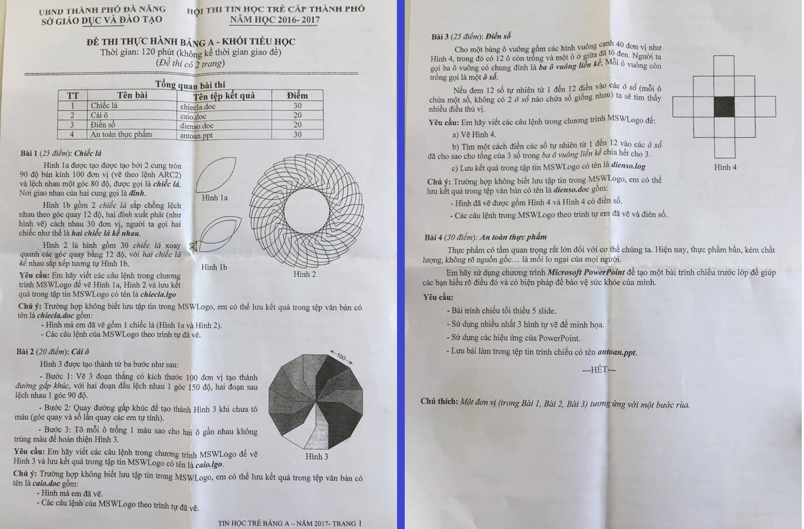

# Đề thi Bảng A - TP Đà Nẵng 2017

Hội thi Tin học trẻ cấp thành phố Đà Nẵng (UBND thành phố Đà Nẵng, Sở Giáo dục và Đào tạo), năm học 2016–2017. Đề thi thực hành Bảng A - Khối Tiểu học, đề thi có 2 trang. Thời gian làm bài: **120 phút** (không kể thời gian giao đề).

Bài thi thực hành ứng dụng: vẽ bằng **MSWLogo**, soạn bài trình chiếu bằng **Microsoft PowerPoint**.

**Chú thích của đề:** Một đơn vị (trong Bài 1, Bài 2, Bài 3) tương ứng với một bước rùa.

!!! warning "Nguồn đề"
    Đề được chép từ ảnh chụp đề thi (`data/new_pdfs/DA NANG/TP ĐÀ NẴNG/ĐÀ NẴNG 2017.jpg`), một ảnh chụp cả 2 trang, đọc rõ. Các hình mẫu (Hình 1a, 1b, 2, 3, 4) xem trong [bản scan](#de-goc-ban-scan).

!!! note "Chỗ không khớp trong đề gốc"
    - **Điểm:** bảng tổng quan ghi Bài 1 = 30, Bài 3 = 20; phần nội dung ghi Bài 1 (25 điểm), Bài 3 (25 điểm). Bảng dưới đây chép theo bảng tổng quan, điểm ở tiêu đề từng bài chép theo phần nội dung.
    - **Tên tệp:** bảng tổng quan ghi tệp `.doc`; phần nội dung yêu cầu lưu tập tin MSWLogo (`chiecla.lgo`, `caio.lgo`, `dienso.log`) và chỉ dùng tệp `.doc` khi không biết lưu tập tin MSWLogo. Đuôi `dienso.log` ở Bài 3 có lẽ là lỗi đánh máy của `dienso.lgo`.

## Tổng quan bài thi

| STT | Bài | Tên tệp kết quả | Điểm |
| ---: | --- | --- | ---: |
| 1 | Chiếc lá | `chiecla.doc` | 30 |
| 2 | Cái ô | `caio.doc` | 20 |
| 3 | Điền số | `dienso.doc` | 20 |
| 4 | An toàn thực phẩm | `antoan.ppt` | 30 |

---

## 1. Chiếc lá (25 điểm)

Hình 1a được tạo được tạo bởi 2 cung tròn 90 độ bán kính 100 đơn vị (vẽ theo lệnh ARC2) và lệch nhau một góc 80 độ, được gọi là ***chiếc lá***. Nơi giao nhau của hai cung gọi là ***đỉnh***.

Hình 1b gồm 2 *chiếc lá* sắp chồng lệch nhau theo góc quay 12 độ, hai *đỉnh* xuất phát (như hình vẽ) cách nhau 30 đơn vị, người ta gọi hai chiếc như thế là ***hai chiếc lá kề nhau***.

Hình 2 là hình gồm 30 *chiếc lá* xoay quanh các góc quay bằng 12 độ, với *hai chiếc lá kề nhau* sắp xếp tương tự Hình 1b.

**Yêu cầu:** Em hãy viết các câu lệnh trong chương trình MSWLogo để vẽ Hình 1a, Hình 2 và lưu kết quả trong tập tin MSWLogo có tên là ***chiecla.lgo***

**Chú ý:** Trường hợp không biết lưu tập tin trong MSWLogo, em có thể lưu kết quả trong tệp văn bản có tên là ***chiecla.doc*** gồm:

- Hình mà em đã vẽ gồm 1 chiếc lá (Hình 1a và Hình 2).
- Các câu lệnh của MSWLogo theo trình tự đã vẽ.

Xem Hình 1a, 1b, 2 trong [bản scan](#de-goc-ban-scan).

---

## 2. Cái ô (20 điểm)

Hình 3 được tạo thành từ ba bước như sau:

- Bước 1: Vẽ 3 đoạn thẳng có kích thước 100 đơn vị tạo thành *đường gấp khúc*, với hai đoạn đầu lệch nhau 1 góc 150 độ, hai đoạn sau lệch nhau 1 góc 90 độ.
- Bước 2: Quay đường gấp khúc để tạo thành Hình 3 khi chưa tô màu (góc quay và số lần quay các em tự tính).
- Bước 3: Tô mỗi ô trống 1 màu sao cho hai ô gần nhau không trùng màu để hoàn thiện Hình 3.

**Yêu cầu:** Em hãy viết các câu lệnh trong chương trình MSWLogo để vẽ Hình 3 và lưu kết quả trong tập tin MSWLogo có tên là ***caio.lgo***.

**Chú ý:** Trường hợp không biết lưu tập tin trong MSWLogo, em có thể lưu kết quả trong tệp văn bản có tên là ***caio.doc*** gồm:

- Hình mà em đã vẽ.
- Các câu lệnh của MSWLogo theo trình tự đã vẽ.

Hình 3 là một hình 12 cạnh (mỗi cạnh ghi 100), bên trong chia thành các ô hình cánh quạt tô màu xen kẽ. Xem Hình 3 trong [bản scan](#de-goc-ban-scan).

---

## 3. Điền số (25 điểm)

Cho một bảng ô vuông gồm các hình vuông cạnh 40 đơn vị như Hình 4, trong đó có 12 ô còn trống và một ô ở giữa đã tô đen. Người ta gọi ba ô vuông có chung đỉnh là ***ba ô vuông liền kề***; Mỗi ô vuông còn trống gọi là một ***ô số***.

Nếu đem 12 số tự nhiên từ 1 đến 12 điền vào các *ô số* (mỗi ô chứa một số, không có 2 *ô số* nào chứa số giống nhau) ta sẽ tìm thấy nhiều điều thú vị.

**Yêu cầu:** Em hãy viết các câu lệnh trong chương trình MSWLogo để:

a) Vẽ Hình 4.

b) Tìm một cách điền các số tự nhiên từ 1 đến 12 vào các *ô số* đã cho sao cho tổng của 3 số trong *ba ô vuông liền kề* chia hết cho 3.

c) Lưu kết quả trong tập tin MSWLogo có tên là ***dienso.log***

**Chú ý:** Trường hợp không biết lưu tập tin trong MSWLogo, em có thể lưu kết quả trong tệp văn bản có tên là ***dienso.doc*** gồm:

- Hình đã vẽ được gồm Hình 4 và Hình 4 có điền số.
- Các câu lệnh trong MSWLogo theo trình tự em đã vẽ và điền số.

Hình 4 có dạng chữ thập (mỗi ô là hình vuông cạnh 40, `#` là ô tô đen, `.` là ô số):

```
    .
  . . .
. . # . .
  . . .
    .
```

Xem Hình 4 trong [bản scan](#de-goc-ban-scan).

---

## 4. An toàn thực phẩm (30 điểm)

Thực phẩm có tầm quan trọng rất lớn đối với cơ thể chúng ta. Hiện nay, thực phẩm bẩn, kém chất lượng, không rõ nguồn gốc… là mối lo ngại của mọi người.

Em hãy sử dụng chương trình ***Microsoft PowerPoint*** để tạo một bài trình chiếu trước lớp để giúp các bạn hiểu rõ điều đó và có biện pháp để bảo vệ sức khỏe của mình.

**Yêu cầu:**

- Bài trình chiếu tối thiểu 5 slide.
- Sử dụng nhiều nhất 3 hình tự vẽ để minh họa.
- Sử dụng các hiệu ứng của PowerPoint.
- Lưu bài làm trong tệp tin trình chiếu có tên ***antoan.ppt***.

---

!!! tip "Đáp án"
    Tự làm trước, sau đó xem [gợi ý hướng làm](dap-an.md).

## Đề gốc (bản scan) {#de-goc-ban-scan}


