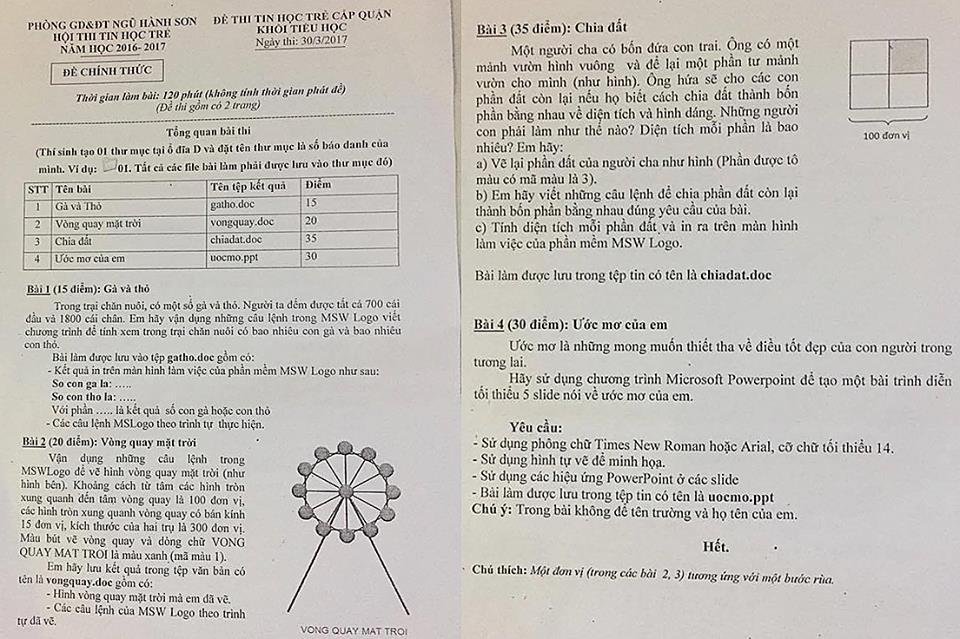

# Đề thi Bảng A - Quận Ngũ Hành Sơn 2017

Hội thi Tin học trẻ cấp quận, Phòng GD&ĐT Ngũ Hành Sơn, năm học 2016–2017. Khối Tiểu học (đề chính thức). Ngày thi: **30/3/2017**. Thời gian làm bài: **120 phút** (không tính thời gian phát đề). Đề thi gồm có 2 trang.

Phần mềm sử dụng: **MSWLogo**, **Microsoft Word** (lưu bài dạng `.doc`) và **Microsoft PowerPoint**.

!!! warning "Nguồn đề"
    Đề được chép từ ảnh chụp đề thi (`DA NANG/NGŨ HÀNH SƠN/NGŨ HÀNH SƠN 2017.jpg`). Đây là đề thực hành ứng dụng (vẽ MSWLogo, soạn văn bản, trình chiếu), không có bài lập trình giải thuật nên không có lời giải Python. Hình mẫu của Bài 2 và Bài 3 xem trong [bản scan](#de-goc-ban-scan).

## Tổng quan bài thi

*(Thí sinh tạo 01 thư mục tại ổ đĩa D và đặt tên thư mục là số báo danh của mình. Ví dụ: 📁01. Tất cả các file bài làm phải được lưu trong thư mục đó)*

| STT | Tên bài | Tên tệp kết quả | Điểm |
| ---: | --- | --- | ---: |
| 1 | Gà và Thỏ | `gatho.doc` | 15 |
| 2 | Vòng quay mặt trời | `vongquay.doc` | 20 |
| 3 | Chia đất | `chiadat.doc` | 35 |
| 4 | Ước mơ của em | `uocmo.ppt` | 30 |

*Chú thích: Một đơn vị (trong các bài 2, 3) tương ứng với một bước rùa.*

---

## 1. Gà và thỏ

Trong trại chăn nuôi, có một số gà và thỏ. Người ta đếm được tất cả 700 cái đầu và 1800 cái chân. Em hãy vận dụng những câu lệnh trong MSW Logo viết chương trình để tính xem trong trại chăn nuôi có bao nhiêu con gà và bao nhiêu con thỏ.

Bài làm được lưu vào tệp **gatho.doc** gồm có:

* Kết quả in trên màn hình làm việc của phần mềm MSW Logo như sau:

```
So con ga la: .....
So con tho la: .....
```

  Với phần ….. là kết quả số con gà hoặc con thỏ.

* Các câu lệnh MSLogo theo trình tự thực hiện.

---

## 2. Vòng quay mặt trời

Vận dụng những câu lệnh trong MSWLogo để vẽ hình vòng quay mặt trời (như hình bên). Khoảng cách từ tâm các hình tròn xung quanh đến tâm vòng quay là 100 đơn vị, các hình tròn xung quanh vòng quay có bán kính 15 đơn vị, kích thước của hai trụ là 300 đơn vị. Màu bút vẽ vòng quay và dòng chữ VONG QUAY MAT TROI là màu xanh (mã màu 1).

Em hãy lưu bài quay trong tệp văn bản có tên là **vongquay.doc** gồm có:

* Hình vòng quay mặt trời mà em đã vẽ.
* Các câu lệnh của MSW Logo theo trình tự đã vẽ.

Xem hình mẫu "VONG QUAY MAT TROI" trong [bản scan](#de-goc-ban-scan).

---

## 3. Chia đất

Một người cha có bốn đứa con trai. Ông có một mảnh vườn hình vuông và để lại một phần tư mảnh vườn cho mình (như hình). Ông hứa sẽ cho các con phần đất còn lại nếu họ biết cách chia đất thành bốn phần bằng nhau về diện tích và hình dáng. Những người con phải làm như thế nào? Diện tích mỗi phần là bao nhiêu? Em hãy:

a) Vẽ lại phần đất của người cha như hình (Phần được tô màu có mã màu là 3).

b) Em hãy viết những câu lệnh để chia phần đất còn lại thành bốn phần bằng nhau đúng yêu cầu của bài.

c) Tính diện tích mỗi phần đất và in ra trên màn hình làm việc của phần mềm MSW Logo.

Bài làm được lưu trong tệp tin có tên là **chiadat.doc**

Hình mẫu: hình vuông cạnh 100 đơn vị chia thành 4 ô vuông bằng nhau, ô góc trên bên phải được tô màu. Xem hình trong [bản scan](#de-goc-ban-scan).

---

## 4. Ước mơ của em

Ước mơ là những mong muốn thiết tha về điều tốt đẹp của con người trong tương lai.

Hãy sử dụng chương trình Microsoft Powerpoint để tạo một bài trình diễn tối thiểu 5 slide nói về ước mơ của em.

**Yêu cầu:**

* Sử dụng phông chữ Times New Roman hoặc Arial, cỡ chữ tối thiểu 14.
* Sử dụng hình tự vẽ để minh họa.
* Sử dụng các hiệu ứng PowerPoint ở các slide.
* Bài làm được lưu trong tệp tin có tên là **uocmo.ppt**

**Chú ý:** Trong bài không để tên trường và họ tên của em.

---

## Đề gốc (bản scan) { #de-goc-ban-scan }



---

!!! tip "Đáp án"
    Tự làm trước, sau đó xem [gợi ý hướng làm](dap-an.md).
