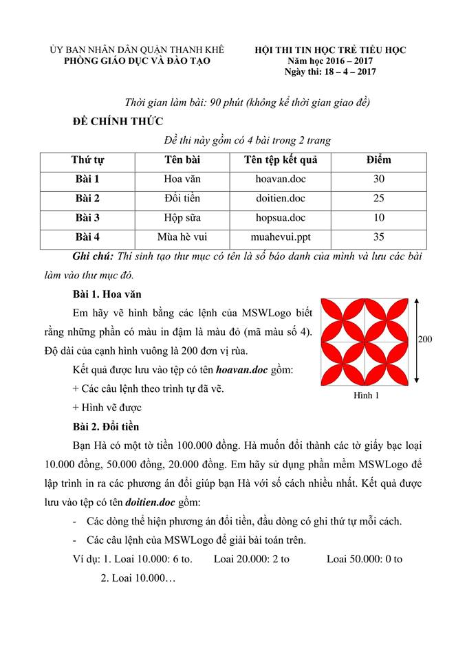

# Đề thi Bảng A - Quận Thanh Khê 2017

Hội thi Tin học trẻ Tiểu học, Phòng Giáo dục và Đào tạo quận Thanh Khê (TP. Đà Nẵng), năm học 2016–2017. Ngày thi: **18/04/2017**. Thời gian làm bài: **90 phút** (không kể thời gian giao đề). Đề chính thức gồm 4 bài trong 2 trang.

Bài thi thực hành ứng dụng: vẽ và lập trình bằng **MSWLogo**, soạn bài trình chiếu bằng **Microsoft PowerPoint**.

**Ghi chú:** Thí sinh tạo thư mục có tên là số báo danh của mình và lưu các bài làm vào thư mục đó.

!!! warning "Nguồn đề"
    Đề được chép từ ảnh chụp đề thi (`data/new_pdfs/DA NANG/THANH KHÊ/THANH KHÊ 2017 (1).jpg` và `(2).jpg`), đủ 2 trang. Hình 1 xem trong [bản scan](#de-goc-ban-scan).

## Tổng quan bài thi

| STT | Bài | Tên tệp kết quả | Điểm |
| ---: | --- | --- | ---: |
| 1 | Hoa văn | `hoavan.doc` | 30 |
| 2 | Đổi tiền | `doitien.doc` | 25 |
| 3 | Hộp sữa | `hopsua.doc` | 10 |
| 4 | Mùa hè vui | `muahevui.ppt` | 35 |

---

## 1. Hoa văn

Em hãy vẽ hình bằng các lệnh của MSWLogo biết rằng những phần có màu in đậm là màu đỏ (mã màu số 4). Độ dài của cạnh hình vuông là 200 đơn vị rùa.

Kết quả được lưu vào tệp có tên ***hoavan.doc*** gồm:

- Các câu lệnh theo trình tự đã vẽ.
- Hình vẽ được.

Xem Hình 1 trong [bản scan](#de-goc-ban-scan).

---

## 2. Đổi tiền

Bạn Hà có một tờ tiền 100.000 đồng. Hà muốn đổi thành các tờ giấy bạc loại 10.000 đồng, 50.000 đồng, 20.000 đồng. Em hãy sử dụng phần mềm MSWLogo để lập trình in ra các phương án đổi tiền giúp bạn Hà với số cách nhiều nhất. Kết quả được lưu vào tệp có tên ***doitien.doc*** gồm:

- Các dòng thể hiện phương án đổi tiền, đầu dòng có ghi thứ tự mỗi cách.
- Các câu lệnh của MSWLogo để giải bài toán trên.

**Ví dụ:**

```
1. Loai 10.000: 6 to.     Loai 20.000: 2 to     Loai 50.000: 0 to
2. Loai 10.000…
```

!!! note "Cách hiểu đề dùng cho lời giải tham khảo"
    "Với số cách nhiều nhất" được hiểu là liệt kê **tất cả** các phương án đổi. Theo ví dụ của đề, một loại tiền có thể không dùng (0 tờ).

---

## 3. Hộp sữa

Một cửa hàng bày các hộp sữa thành các hàng chồng lên nhau, hàng trên kém hàng dưới một hộp. Biết rằng hàng trên cùng có một hộp và tổng số hộp sữa được dùng để xếp là 120 hộp. Bằng của MSWLogo, em hãy lập trình để in lên màn hình số hộp sữa ở hàng dưới cùng. Có vẽ hình minh họa, mỗi hộp sữa là một ô vuông có độ dài các cạnh là 20x20 đơn vị rùa.

Kết quả được lưu vào tệp có tên **hopsua.doc** gồm:

- Các câu lệnh của MSWLogo để giải bài toán trên
- Hình vẽ được

---

## 4. Mùa hè vui

Mùa hè đến, các em học sinh được nghỉ học. Đây là thời điểm thú vị nhất đối với các em bởi bao ước mơ, mong muốn được vui chơi thỏa thích, được tham gia các hoạt động hè hoặc được về quê thăm ông bà,… và đó sẽ là những kỷ niệm đáng nhớ của tuổi học trò. Em hãy dùng phần mềm trình chiếu Microsoft Power Point để nói về những dự định của em trong dịp nghỉ hè sắp tới.

*Chú ý: Trong bài làm không để tên trường và họ tên của em.*

**Yêu cầu bài trình diễn:**

- Bài trình chiếu tối thiểu 5 trang (slide)
- Sử dụng nhiều nhất 3 hình tự vẽ minh họa.
- Sử dụng các hiệu ứng của Power Point.
- Lưu bài làm trong tệp tin trình chiếu có tên ***muahevui.ppt***

---

!!! tip "Đáp án"
    Tự làm trước, sau đó xem [gợi ý hướng làm](dap-an.md).

## Đề gốc (bản scan) { #de-goc-ban-scan }


