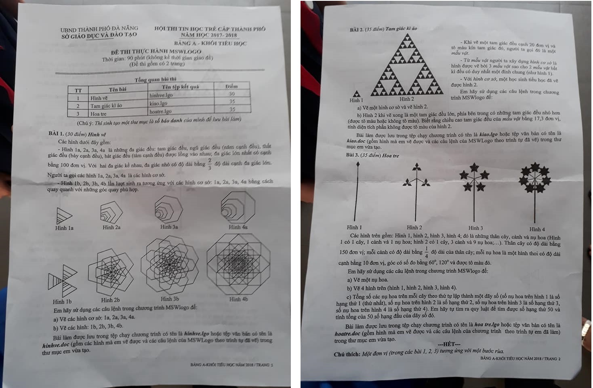

# Đề thi Bảng A - TP Đà Nẵng 2018

Hội thi Tin học trẻ cấp thành phố Đà Nẵng (UBND thành phố Đà Nẵng, Sở Giáo dục và Đào tạo), năm học 2017–2018. **Đề thi thực hành MSWLogo** Bảng A - Khối Tiểu học, đề thi gồm có 2 trang. Thời gian làm bài: **90 phút** (không kể thời gian giao đề).

**Chú ý của đề:** Thí sinh tạo một thư mục là số báo danh của mình để lưu bài làm.

**Chú thích của đề:** Một đơn vị (trong các bài 1, 2, 3) tương ứng với một bước rùa.

!!! warning "Nguồn đề"
    Đề được chép từ ảnh chụp đề thi (`data/new_pdfs/DA NANG/TP ĐÀ NẴNG/DA NANG 2018.jpg`), một ảnh chụp cả 2 trang. Chữ hơi mờ ở mép trang 1 nhưng đọc được đầy đủ. Các hình mẫu xem trong [bản scan](#de-goc-ban-scan).

## Tổng quan bài thi

| STT | Bài | Tên tệp kết quả | Điểm |
| ---: | --- | --- | ---: |
| 1 | Hình vẽ | `hinhve.lgo` | 30 |
| 2 | Tam giác kì ảo | `kiao.lgo` | 35 |
| 3 | Hoa tre | `hoatre.lgo` | 35 |

---

## 1. Hình vẽ

Các hình dưới đây gồm:

- Hình 1a, 2a, 3a, 4a là những đa giác đều: tam giác đều, ngũ giác đều (năm cạnh đều), thất giác đều (bảy cạnh đều), bát giác đều (tám cạnh đều) được lồng vào nhau; đa giác lớn nhất có cạnh bằng 100 đơn vị. Với hai đa giác kề nhau, đa giác nhỏ có độ dài bằng $\frac{2}{3}$ độ dài cạnh đa giác lớn. Người ta gọi các hình 1a, 2a, 3a, 4a là các *hình cơ sở*.
- Hình 1b, 2b, 3b, 4b lần lượt sinh ra tương ứng với các hình *cơ sở*: 1a, 2a, 3a, 4a bằng cách quay quanh với những góc quay phù hợp.

Em hãy sử dụng các câu lệnh trong chương trình MSWlogo để:

a) Vẽ các hình cơ sở: 1a, 2a, 3a, 4a.

b) Vẽ các hình: 1b, 2b, 3b, 4b.

Bài làm được lưu trong tệp chạy chương trình có tên là ***hinhve.lgo*** hoặc tệp văn bản có tên là ***hinhve.doc*** (gồm các hình mà em vẽ được và các câu lệnh của MSWLogo theo trình tự đã vẽ) trong thư mục em vừa tạo.

Xem các hình 1a–4a, 1b–4b trong [bản scan](#de-goc-ban-scan).

---

## 2. Tam giác kì ảo

- Khi vẽ một tam giác đều cạnh 20 đơn vị và tô màu kín tam giác đó, người ta gọi đó là một *mẫu vật*.
- Từ *mẫu vật* người ta xây dựng *hình cơ sở* là hình được vẽ bởi 3 *mẫu vật* sao cho 2 *mẫu vật* bất kì đều có duy nhất một đỉnh chung (như hình 1).
- Với *hình cơ sở*, một học sinh tiểu học đã vẽ được hình 2.

Em hãy sử dụng các câu lệnh trong chương trình MSWlogo để:

a) Vẽ một hình cơ sở và vẽ hình 2.

b) Hình 2 khi vẽ xong là một tam giác đều lớn, phía bên trong có những tam giác đều nhỏ hơn (được tô màu hoặc không tô màu). Biết rằng chiều cao tam giác đều của *mẫu vật* bằng 17,3 đơn vị, tính diện tích phần không được tô màu của hình 2.

Bài làm được lưu trong tệp chạy chương trình có tên là ***kiao.lgo*** hoặc tệp văn bản có tên là ***kiao.doc*** (gồm hình mà em vẽ được và các câu lệnh của MSWLogo theo trình tự đã vẽ) trong thư mục em vừa tạo.

Hình 2 là tam giác Sierpinski: cạnh đáy có 8 *hình cơ sở* xếp liền nhau. Xem Hình 1, Hình 2 trong [bản scan](#de-goc-ban-scan).

---

## 3. Hoa tre

Các hình trên gồm: Hình 1, hình 2, hình 3, hình 4; đó là những thân cây, cành và nụ hoa (Hình 1 có 1 cây, 1 cành và 1 nụ hoa; hình 2 có 1 cây, 3 cành và 9 nụ hoa;…). Thân cây có độ dài bằng 150 đơn vị; mỗi cành có độ dài bằng $\frac{1}{4}$ độ dài của thân cây; mỗi nụ hoa là một hình thoi có độ dài cạnh bằng 10 đơn vị, góc có số đo bằng $60^\circ$, $120^\circ$ và được tô màu đỏ.

Em hãy sử dụng các câu lệnh trong chương trình MSWlogo để:

a) Vẽ một nụ hoa.

b) Vẽ 4 hình trên (hình 1, hình 2, hình 3, hình 4).

c) Tổng số các nụ hoa trên mỗi cây theo thứ tự lập thành một dãy số (số nụ hoa trên hình 1 là số hạng thứ 1 (thứ nhất), số nụ hoa trên hình 2 là số hạng thứ 2, số nụ hoa trên hình 3 là số hạng thứ 3, số nụ hoa trên hình 4 là số hạng thứ 4). Em hãy tự tìm ra quy luật để tìm được số hạng thứ 50 và tính tổng của 50 số hạng đầu của dãy số đó.

Bài làm được lưu trong tệp chạy chương trình có tên là ***hoa tre.lgo*** hoặc tệp văn bản có tên là ***hoatre.doc*** (gồm hình mà em vẽ được và các câu lệnh của chương trình theo trình tự em đã làm) trong thư mục em vừa tạo.

Xem Hình 1–4 trong [bản scan](#de-goc-ban-scan). Tên tệp trong phần nội dung ghi `hoa tre.lgo` (có dấu cách), bảng tổng quan ghi `hoatre.lgo`.

!!! note "Cách hiểu đề dùng cho lời giải tham khảo"
    Đề chỉ ghi số liệu của hình 1 và hình 2. Đếm trên ảnh chụp: hình 3 có 5 cành, mỗi cành một bông gồm 5 nụ; hình 4 có 7 cành, mỗi cành một bông gồm 7 nụ (ảnh chụp nhỏ, đếm có thể sai). Gợi ý ở trang đáp án dùng cách đếm này.

---

!!! tip "Đáp án"
    Tự làm trước, sau đó xem [gợi ý hướng làm](dap-an.md).

## Đề gốc (bản scan) {#de-goc-ban-scan}

