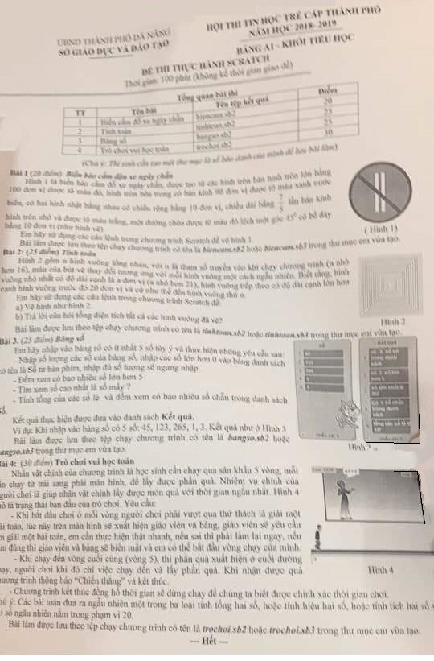

# Đề thi Bảng A - TP Đà Nẵng 2019

Hội thi Tin học trẻ cấp thành phố Đà Nẵng (UBND thành phố Đà Nẵng, Sở Giáo dục và Đào tạo), năm học 2018–2019. **Đề thi thực hành Scratch** Bảng A1 - Khối Tiểu học. Thời gian làm bài: **100 phút** (không kể thời gian giao đề).

Thí sinh lập trình bằng **Scratch**, lưu bài làm dạng tệp `.sb2` hoặc `.sb3`.

**Chú ý của đề:** Thí sinh cần tạo một thư mục là số báo danh của mình để lưu bài làm.

!!! warning "Nguồn đề"
    Đề được chép từ ảnh chụp đề thi (`data/new_pdfs/DA NANG/TP ĐÀ NẴNG/DA NANG 2019.jpg`), 1 trang. Ảnh chụp có độ phân giải thấp và bị mờ: tên bảng thi đọc được là "Bảng A1", thời gian làm bài đọc được là 100 phút; mép trái ở Bài 4 bị mất vài chữ đầu dòng, đã khôi phục theo ngữ cảnh. Nội dung Hình 3 (danh sách **Kết quả** của Bài 3) **không đọc rõ**. Phần "Dữ liệu", "Kết quả" và "Ví dụ" của Bài 2 và Bài 3 do nhóm biên soạn bổ sung để luyện tập bằng Python, **không phải đề gốc**. Các hình mẫu xem trong [bản scan](#de-goc-ban-scan).

## Tổng quan bài thi

| STT | Bài | Tên tệp kết quả | Điểm |
| ---: | --- | --- | ---: |
| 1 | Biển cấm đỗ xe ngày chẵn | `biencam.sb2` | 20 |
| 2 | Tính toán | `tinhtoan.sb2` | 25 |
| 3 | Bảng số | `bangso.sb2` | 25 |
| 4 | Trò chơi vui học toán | `trochoi.sb2` | 30 |

---

## 1. Biển báo cấm đậu xe ngày chẵn

Hình 1 là biển báo cấm đỗ xe ngày chẵn, được tạo từ các hình tròn bán kính hình tròn lớn bằng 100 đơn vị được tô màu đỏ, hình tròn bên trong có bán kính 90 đơn vị được tô màu xanh nước biển, có hai hình nhật bằng nhau có chiều rộng bằng 10 đơn vị, chiều dài bằng $\frac{7}{5}$ lần bán kính hình tròn nhỏ và được tô màu trắng, một đường chéo được tô màu đỏ lệch một góc $45^\circ$ có bề dày bằng 10 đơn vị (như hình vẽ).

Em hãy sử dụng các câu lệnh trong chương trình Scratch để vẽ hình 1.

Bài làm được lưu theo tệp chạy chương trình có tên là ***biencam.sb2*** hoặc ***biencam.sb3*** trong thư mục em vừa tạo.

Xem Hình 1 trong [bản scan](#de-goc-ban-scan).

---

## 2. Tính toán

Hình 2 gồm n hình vuông lồng nhau, với n là tham số truyền vào khi chạy chương trình (n nhỏ hơn 16), màu của bút vẽ thay đổi tương ứng với mỗi hình vuông một cách ngẫu nhiên. Biết rằng, hình vuông nhỏ nhất có độ dài cạnh là a đơn vị (a nhỏ hơn 21), hình vuông tiếp theo có độ dài cạnh lớn hơn cạnh hình vuông trước đó 20 đơn vị và cứ như thế đến hình vuông thứ n.

Em hãy sử dụng các câu lệnh trong chương trình Scratch để:

a) Vẽ hình như hình 2.

b) Trả lời câu hỏi tổng diện tích tất cả các hình vuông đã vẽ?

Bài làm được lưu theo tệp chạy chương trình có tên là ***tinhtoan.sb2*** hoặc ***tinhtoan.sb3*** trong thư mục em vừa tạo.

- **Ràng buộc:** $n < 16$, $a < 21$.

### Dữ liệu (bổ sung)

* Dòng 1: số nguyên dương $n$ ($n < 16$).
* Dòng 2: số nguyên dương $a$ ($a < 21$).

### Kết quả (bổ sung)

* Tổng diện tích tất cả các hình vuông đã vẽ.

### Ví dụ 1 (bổ sung)

#### Nhập vào

```
3
10
```

#### In ra

```
3500
```

#### Giải thích

* Ba hình vuông có cạnh 10, 30, 50; tổng diện tích $100 + 900 + 2500 = 3500$.

### Ví dụ 2 (bổ sung)

#### Nhập vào

```
15
20
```

#### In ra

```
496000
```

---

## 3. Bảng số

Em hãy nhập vào bảng số có ít nhất 5 số tùy ý và thực hiện những yêu cầu sau:

- Nhập số lượng các số của bảng số, nhập các số lớn hơn 0 vào bảng danh sách có tên là **Số** từ bàn phím, nhập đủ số lượng sẽ ngưng nhập.
- Đếm xem có bao nhiêu số lớn hơn 5
- Tìm xem số cao nhất là số mấy ?
- Tính tổng của các số lẻ và đếm xem có bao nhiêu số chẵn trong danh sách số.

Kết quả thực hiện được đưa vào danh sách **Kết quả**.

Ví dụ: Khi nhập vào bảng số có 5 số: 45, 123, 265, 1, 3. Kết quả như ở Hình 3

Bài làm được lưu theo tệp chạy chương trình có tên là ***bangso.sb2*** hoặc ***bangso.sb3*** trong thư mục em vừa tạo.

!!! info "Hình 3 không đọc rõ"
    Hình 3 là ảnh chụp màn hình Scratch gồm danh sách **Số** (45, 123, 265, 1, 3) và danh sách **Kết quả** có 5 dòng chữ, nhưng chữ trong danh sách Kết quả quá mờ, không đọc được. Phần định dạng bên dưới là bổ sung; kết quả ví dụ lấy từ lời giải đã chạy.

### Dữ liệu (bổ sung)

* Dòng 1: số lượng $n$ ($n \ge 5$).
* $n$ dòng tiếp theo: mỗi dòng một số nguyên lớn hơn 0.

### Kết quả (bổ sung)

In 4 dòng (danh sách **Kết quả**):

* Dòng 1: số lượng số lớn hơn 5.
* Dòng 2: số lớn nhất.
* Dòng 3: tổng các số lẻ.
* Dòng 4: số lượng số chẵn.

### Ví dụ 1 (theo đề, đầu ra bổ sung)

#### Nhập vào

```
5
45
123
265
1
3
```

#### In ra

```
3
265
437
0
```

#### Giải thích

* Các số lớn hơn 5: 45, 123, 265 (3 số). Số lớn nhất: 265.
* Cả 5 số đều lẻ: tổng $45 + 123 + 265 + 1 + 3 = 437$; không có số chẵn nào.

### Ví dụ 2 (bổ sung)

#### Nhập vào

```
6
2
8
5
6
10
7
```

#### In ra

```
4
10
12
4
```

---

## 4. Trò chơi vui học toán

Nhân vật chính của chương trình là học sinh cần chạy qua sân khấu 5 vòng, mỗi lần chạy từ trái sang phải màn hình, để lấy được phần quà. Nhiệm vụ chính của người chơi là giúp nhân vật chính lấy được món quà với thời gian ngắn nhất. Hình 4 mô tả trạng thái ban đầu của trò chơi. Yêu cầu:

- Khi bắt đầu chơi ở mỗi vòng người chơi phải vượt qua thử thách là giải một bài toán, lúc này trên màn hình sẽ xuất hiện giáo viên và bảng, giáo viên sẽ yêu cầu em giải một bài toán, em cần thực hiện thật nhanh, nếu sai thì phải làm lại ngay, nếu em đúng thì giáo viên và bảng sẽ biến mất và em có thể bắt đầu vòng chạy của mình.
- Khi chạy đến vòng cuối cùng (vòng 5), thì phần quà xuất hiện ở cuối đường chạy, người chơi khi đó chỉ việc chạy đến và lấy phần quà. Khi nhận được quà chương trình thông báo "Chiến thắng" và kết thúc.
- Chương trình kết thúc đồng hồ thời gian sẽ dừng chạy để chúng ta biết được chính xác thời gian chơi.

Chú ý: Các bài toán đưa ra ngẫu nhiên một trong ba loại tính tổng hai số, hoặc tính hiệu hai số, hoặc tính tích hai số với số ngẫu nhiên nằm trong phạm vi 20.

Bài làm được lưu theo tệp chạy chương trình có tên là ***trochoi.sb2*** hoặc ***trochoi.sb3*** trong thư mục em vừa tạo.

Xem Hình 4 trong [bản scan](#de-goc-ban-scan).

---

!!! tip "Đáp án"
    Tự làm trước, sau đó xem [lời giải tham khảo](dap-an.md).

## Đề gốc (bản scan) {#de-goc-ban-scan}


