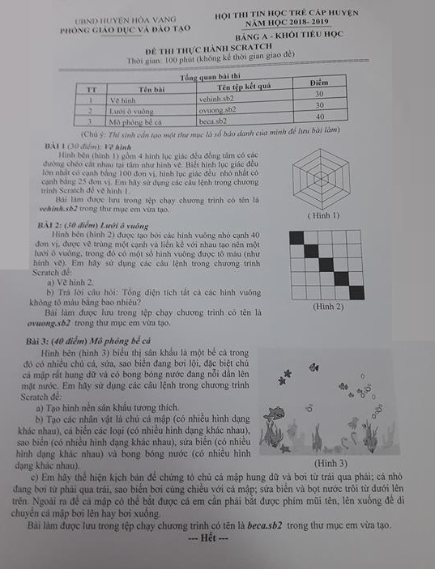

# Đề thi Bảng A - Huyện Hòa Vang 2019

Hội thi Tin học trẻ cấp huyện, Phòng Giáo dục và Đào tạo huyện Hòa Vang (TP. Đà Nẵng), năm học 2018–2019. Bảng A - Khối Tiểu học, **đề thi thực hành Scratch**. Thời gian: **100 phút** (không kể thời gian giao đề).

Thí sinh cần tạo một thư mục là số báo danh của mình để lưu bài làm.

!!! warning "Nguồn đề"
    Đề được chép từ ảnh chụp đề thi *HÒA VANG/HÒA VANG 2019.jpg* (bộ đề Đà Nẵng). Ảnh chụp có độ phân giải thấp nhưng đọc được toàn bộ chữ. Đề không ghi ngày thi. Cả 3 bài đều là bài thực hành vẽ hình / làm hoạt hình bằng Scratch, nên không có lời giải Python.

## Tổng quan bài thi

| STT | Bài | Tên tệp kết quả | Điểm |
| ---: | --- | --- | ---: |
| 1 | Vẽ hình | `vehinh.sb2` | 30 |
| 2 | Lưới ô vuông | `ovuong.sb2` | 30 |
| 3 | Mô phỏng bể cá | `beca.sb2` | 40 |

---

## 1. Vẽ hình

Hình bên (hình 1) gồm 4 hình lục giác đều đồng tâm có các đường chéo cắt nhau tại tâm như hình vẽ. Biết hình lục giác đều lớn nhất có cạnh bằng 100 đơn vị, hình lục giác đều nhỏ nhất có cạnh bằng 25 đơn vị. Em hãy sử dụng các câu lệnh trong chương trình Scratch để vẽ hình 1.

Bài làm được lưu trong tệp chạy chương trình có tên là `vehinh.sb2` trong thư mục em vừa tạo.

Xem hình 1 trong [bản scan](#de-goc-ban-scan).

---

## 2. Lưới ô vuông

Hình bên (hình 2) được tạo bởi các hình vuông nhỏ cạnh 40 đơn vị, được vẽ trùng một cạnh và liền kề với nhau tạo nên một lưới ô vuông, trong đó có một số hình vuông được tô màu (như hình vẽ). Em hãy sử dụng các câu lệnh trong chương trình Scratch để:

a) Vẽ hình 2.

b) Trả lời câu hỏi: Tổng diện tích tất cả các hình vuông không tô màu bằng bao nhiêu?

Bài làm được lưu trong tệp chạy chương trình có tên là `ovuong.sb2` trong thư mục em vừa tạo.

Hình 2 (xem [bản scan](#de-goc-ban-scan)) là lưới $5 \times 5$ ô vuông, các ô trên đường chéo từ góc trên bên trái xuống góc dưới bên phải được tô màu đen.

---

## 3. Mô phỏng bể cá

Hình bên (hình 3) biểu thị sân khấu là một bể cá trong đó có nhiều chú cá, sứa, sao biển đang bơi lội, đặc biệt chú cá mập rất hung dữ và có bong bóng nước đang nổi dần lên mặt nước. Em hãy sử dụng các câu lệnh trong chương trình Scratch để:

a) Tạo hình nền sân khấu tương thích.

b) Tạo các nhân vật là chú cá mập (có nhiều hình dạng khác nhau), cá biển các loại (có nhiều hình dạng khác nhau), sao biển (có nhiều hình dạng khác nhau), sứa biển (có nhiều hình dạng khác nhau) và bong bóng nước (có nhiều hình dạng khác nhau).

c) Em hãy thể hiện kịch bản để chứng tỏ chú cá mập hung dữ và bơi từ trái qua phải; cá nhỏ đang bơi từ phải qua trái, sao biển bơi cùng chiều với cá mập; sứa biển và bọt nước trôi từ dưới lên trên. Ngoài ra để cá mập có thể bắt được cá em cần phải bắt được phím mũi tên, lên xuống để di chuyển cá mập bơi lên hay bơi xuống.

Bài làm được lưu trong tệp chạy chương trình có tên là `beca.sb2` trong thư mục em vừa tạo.

---

## Đề gốc (bản scan) { #de-goc-ban-scan }

---

!!! tip "Đáp án"
    Tự làm trước, sau đó xem [gợi ý hướng làm](dap-an.md).
