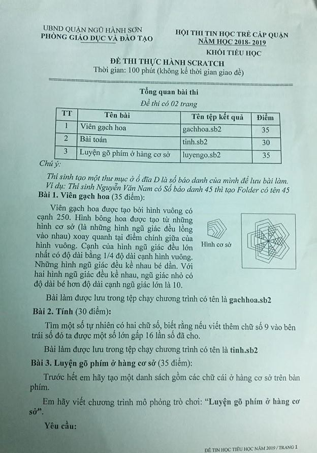
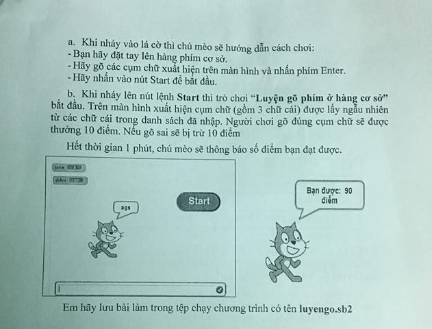

# Đề thi Bảng A - Quận Ngũ Hành Sơn 2019

Hội thi Tin học trẻ cấp quận, Phòng Giáo dục và Đào tạo quận Ngũ Hành Sơn, năm học 2018–2019. Khối Tiểu học - **Đề thi thực hành Scratch**. Thời gian: **100 phút** (không kể thời gian giao đề). Đề thi có 02 trang.

!!! warning "Nguồn đề"
    Đề được chép từ ảnh chụp đề thi (`DA NANG/NGŨ HÀNH SƠN/NGŨ HÀNH SƠN 2019 (1).jpg` và `NGŨ HÀNH SƠN 2019 (2).jpg`, hai trang của cùng một đề). Ảnh không ghi ngày thi. Bài 1 và Bài 3 là bài vẽ / làm trò chơi trong Scratch, chấm theo sản phẩm, nên không có lời giải Python. Hình mẫu của Bài 1 và màn hình mẫu của Bài 3 xem trong [bản scan](#de-goc-ban-scan).

## Tổng quan bài thi

| TT | Tên bài | Tên tệp kết quả | Điểm |
| ---: | --- | --- | ---: |
| 1 | Viên gạch hoa | `gachhoa.sb2` | 35 |
| 2 | Bài toán | `tinh.sb2` | 30 |
| 3 | Luyện gõ phím ở hàng cơ sở | `luyengo.sb2` | 35 |

*Chú ý: Thí sinh tạo một thư mục ở ổ đĩa D là số báo danh của mình để lưu bài làm. Ví dụ: Thí sinh Nguyễn Văn Nam có Số báo danh 45 thì tạo Folder có tên 45.*

---

## 1. Viên gạch hoa

Viên gạch hoa được tạo bởi hình vuông có cạnh 250. Hình bông hoa được tạo từ những hình cơ sở (là những hình ngũ giác đều lồng vào nhau) xoay quanh tại điểm chính giữa của hình vuông. Cạnh của hình ngũ giác đều lớn nhất có độ dài bằng 1/4 độ dài cạnh hình vuông. Những hình ngũ giác đều kề nhau bé dần. Với hai hình ngũ giác đều kề nhau, ngũ giác nhỏ có độ dài bé hơn độ dài cạnh ngũ giác lớn là 10.

Bài làm được lưu trong tệp chạy chương trình có tên là **gachhoa.sb2**

Xem "Hình cơ sở" và hình viên gạch hoa mẫu trong [bản scan](#de-goc-ban-scan).

---

## 2. Tính

Tìm một số tự nhiên có hai chữ số, biết rằng nếu viết thêm chữ số 9 vào bên trái số đó ta được một số lớn gấp 16 lần số đã cho.

Bài làm được lưu trong tệp chạy chương trình có tên là **tinh.sb2**

!!! note "Cách hiểu đề dùng cho lời giải tham khảo"
    Đề không có dữ liệu vào. Chương trình chỉ cần tìm và đưa ra (in ra / cho nhân vật nói) số cần tìm.

---

## 3. Luyện gõ phím ở hàng cơ sở

Trước hết em hãy tạo một danh sách gồm các chữ cái ở hàng cơ sở trên bàn phím.

Em hãy viết chương trình mô phỏng trò chơi: **"Luyện gõ phím ở hàng cơ sở"**.

**Yêu cầu:**

a. Khi nháy vào lá cờ thì chú mèo sẽ hướng dẫn cách chơi:

* Bạn hãy đặt tay lên hàng phím cơ sở.
* Hãy gõ các cụm chữ xuất hiện trên màn hình và nhấn phím Enter.
* Hãy nhấn vào nút Start để bắt đầu.

b. Khi nháy lên nút lệnh **Start** thì trò chơi **"Luyện gõ phím ở hàng cơ sở"** bắt đầu. Trên màn hình xuất hiện cụm chữ (gồm 3 chữ cái) được lấy ngẫu nhiên từ các chữ cái trong danh sách đã nhập. Người chơi gõ đúng cụm chữ sẽ được thưởng 10 điểm. Nếu gõ sai sẽ bị trừ 10 điểm.

Hết thời gian 1 phút, chú mèo sẽ thông báo số điểm bạn đạt được.

Màn hình mẫu (xem trong [bản scan](#de-goc-ban-scan)): có hai biến hiển thị "time" và "điểm", nút **Start**, mèo nói cụm chữ (ví dụ "ags"), ô nhập câu trả lời ở dưới; khi hết giờ mèo nói "Bạn được: 90 điểm".

Em hãy lưu bài làm trong tệp chạy chương trình có tên là **luyengo.sb2**

---

## Đề gốc (bản scan) { #de-goc-ban-scan }

---

!!! tip "Đáp án"
    Tự làm trước, sau đó xem [lời giải tham khảo](dap-an.md).
