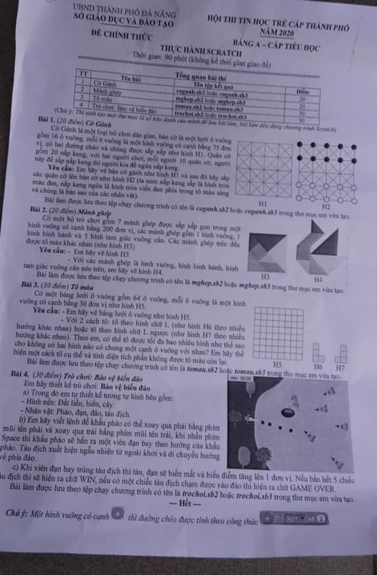

# Đề thi Bảng A - TP Đà Nẵng 2020

Hội thi Tin học trẻ cấp thành phố năm 2020, UBND thành phố Đà Nẵng - Sở Giáo dục và Đào tạo. Đề thi Bảng A - Cấp Tiểu học, **thực hành Scratch** (đề chính thức). Thời gian làm bài: **90 phút** (không kể thời gian giao đề).

*Chú ý: Thí sinh tạo một thư mục là số báo danh của mình để lưu bài làm, bài làm đều dùng chương trình Scratch.*

!!! warning "Nguồn đề"
    Đề được chép từ ảnh chụp đề thi *ĐÀ NẴNG 2020.jpg* (thư mục `data/new_pdfs/DA NANG/TP ĐÀ NẴNG/`). Ảnh có độ phân giải thấp; chữ đọc được nhưng các hình H1–H7 và hình minh họa Bài 4 chỉ xem được ở mức sơ lược. Đề không ghi ngày thi. Cả 4 bài đều là bài thực hành Scratch (vẽ hình, thiết kế trò chơi), cần xem hình trong [bản scan](#de-goc-ban-scan).

## Tổng quan bài thi

| TT | Tên bài | Tên tệp kết quả | Điểm |
| ---: | --- | --- | ---: |
| 1 | Cờ Gánh | `coganh.sb2` hoặc `coganh.sb3` | 20 |
| 2 | Mảnh ghép | `mghep.sb2` hoặc `mghep.sb3` | 20 |
| 3 | Tô màu | `tomau.sb2` hoặc `tomau.sb3` | 30 |
| 4 | Trò chơi: Bảo vệ biển đảo | `trochoi.sb2` hoặc `trochoi.sb3` | 30 |

---

## 1. Cờ Gánh

*(20 điểm)*

Cờ Gánh là một loại trò chơi dân gian, bàn cờ là một lưới ô vuông gồm 16 ô vuông, mỗi ô vuông là một hình vuông có cạnh bằng 75 đơn vị, có hai đường chéo và chúng được sắp xếp như hình H1. Quân cờ gồm 20 nắp keng, với hai người chơi, mỗi người 10 quân cờ, người này để sấp nắp keng thì người kia để ngửa nắp keng.

**Yêu cầu:** Em hãy vẽ bàn cờ gánh như hình H1 và sau đó hãy sắp các quân cờ lên bàn cờ như hình H2 (ta xem nắp keng sấp là hình tròn màu đen, nắp keng ngửa là hình tròn viền đen phía trong tô màu sáng và chúng là bản sao của các nhân vật).

Bài làm được lưu theo tệp chạy chương trình có tên là `coganh.sb2` hoặc `coganh.sb3` trong thư mục em vừa tạo.

Xem hình H1, H2 trong [bản scan](#de-goc-ban-scan). Theo hình H2: 10 quân đen xếp ở 2 hàng điểm trên cùng, 10 quân trắng xếp ở 2 hàng điểm dưới cùng của bàn cờ (lưới 5 × 5 điểm).

---

## 2. Mảnh ghép

*(20 điểm)*

Có một bộ trò chơi gồm 7 mảnh ghép được sắp xếp gọn trong một hình vuông có cạnh bằng 200 đơn vị, các mảnh ghép gồm 1 hình vuông, 1 hình bình hành và 5 hình tam giác vuông cân. Các mảnh ghép trên đều được tô màu khác nhau (như hình H3).

**Yêu cầu:**

- Em hãy vẽ hình H3.
- Với các mảnh ghép là hình vuông, hình bình hành, hình tam giác vuông cân nêu trên, em hãy vẽ hình H4.

Bài làm được lưu theo tệp chạy chương trình có tên là `mghep.sb2` hoặc `mghep.sb3` trong thư mục em vừa tạo.

Xem hình H3, H4 trong [bản scan](#de-goc-ban-scan).

---

## 3. Tô màu

*(30 điểm)*

Có một bảng lưới ô vuông gồm 64 ô vuông, mỗi ô vuông là một hình vuông có cạnh bằng 30 đơn vị như hình H5.

**Yêu cầu:**

- Em hãy vẽ bảng lưới ô vuông như hình H5.
- Với 2 cách tô: tô theo hình chữ L (như hình H6 theo nhiều hướng khác nhau) hoặc tô theo hình chữ L ngược (như hình H7 theo nhiều hướng khác nhau). Theo em, có thể tô được tối đa bao nhiêu hình như thế sao cho không có hai hình nào có chung một cạnh ô vuông với nhau? Em hãy thể hiện một cách tô cụ thể và tính diện tích phần không được tô màu còn lại.

Bài làm được lưu theo tệp chạy chương trình có tên là `tomau.sb2` hoặc `tomau.sb3` trong thư mục em vừa tạo.

Xem hình H5, H6, H7 trong [bản scan](#de-goc-ban-scan). Trên bản scan, H5 là lưới 8 × 8 ô; H6 là hình chữ L gồm 4 ô (3 ô xếp dọc và 1 ô bên phải ô dưới cùng); H7 là chữ L ngược (3 ô xếp dọc và 1 ô bên trái ô dưới cùng).

---

## 4. Trò chơi: Bảo vệ biển đảo

*(30 điểm)*

Em hãy thiết kế trò chơi: **Bảo vệ biển đảo**

a) Trong đó em tự thiết kế tương tự hình bên gồm:

- Hình nền: Đất liền, biển, cây.
- Nhân vật: Pháo, đạn, đảo, tàu địch.

b) Em hãy viết lệnh để khẩu pháo có thể xoay qua phải bằng phím mũi tên phải và xoay qua trái bằng phím mũi tên trái, khi nhấn phím Space thì khẩu pháo sẽ bắn ra một viên đạn bay theo hướng của khẩu pháo. Tàu địch xuất hiện ngẫu nhiên từ ngoài khơi và di chuyển hướng về phía đảo.

c) Khi viên đạn bay trúng tàu địch thì tàu, đạn sẽ biến mất và biến điểm tăng lên 1 đơn vị. Nếu bắn hết 5 chiếc tàu địch thì sẽ hiện ra chữ WIN, nếu có một chiếc tàu địch chạm được vào đảo thì hiện ra chữ GAME OVER.

Bài làm được lưu theo tệp chạy chương trình có tên là `trochoi.sb2` hoặc `trochoi.sb3` trong thư mục em vừa tạo.

Xem hình minh họa trong [bản scan](#de-goc-ban-scan).

---

*Chú ý (cuối đề gốc): Một hình vuông có cạnh (a) thì đường chéo được tính theo công thức (a) \* (sqrt của 2) — trên đề in bằng khối lệnh Scratch, ảnh chụp mờ nên chỉ đọc được ở mức này.*

---

## Đề gốc (bản scan) { #de-goc-ban-scan }

Ảnh đã được cắt bỏ phần mép trên (có ghi chú viết tay không thuộc nội dung đề).

---

!!! tip "Đáp án"
    Tự làm trước, sau đó xem [gợi ý hướng làm](dap-an.md).
