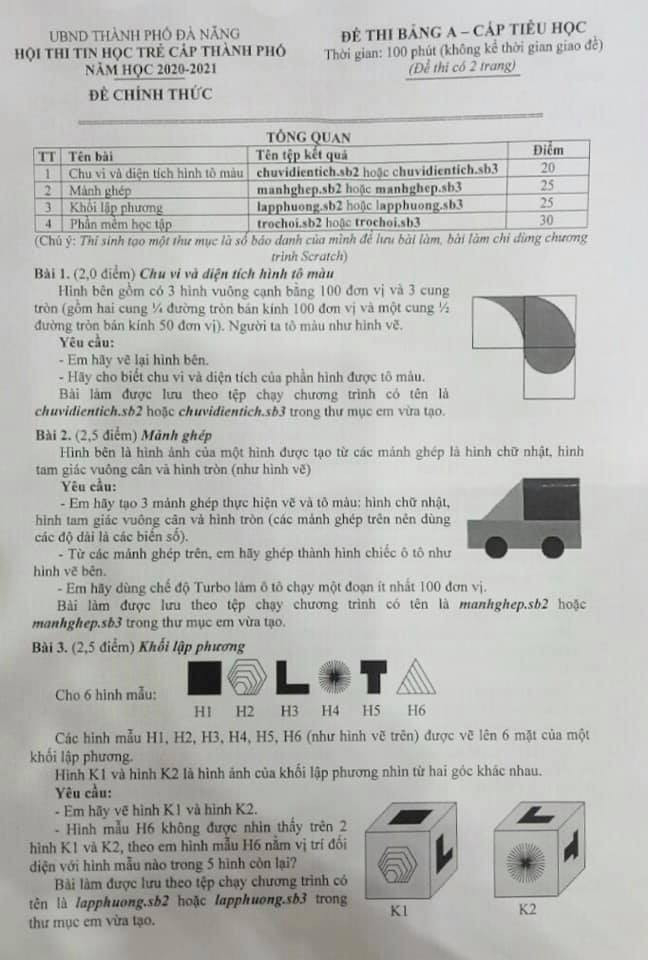
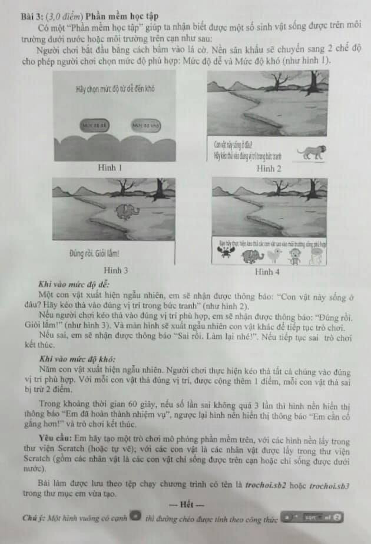

# Đề thi Bảng A - TP Đà Nẵng 2021

Hội thi Tin học trẻ cấp thành phố, UBND thành phố Đà Nẵng, năm học 2020–2021. Đề thi Bảng A - Cấp Tiểu học (đề chính thức, đề thi có 2 trang). Thời gian làm bài: **100 phút** (không kể thời gian giao đề), ngôn ngữ **Scratch**.

*Chú ý: Thí sinh tạo một thư mục là số báo danh của mình để lưu bài làm, bài làm chỉ dùng chương trình Scratch.*

!!! warning "Nguồn đề"
    Đề được chép từ 2 ảnh chụp đề thi thực hành *ĐÀ NẴNG 2021 - TH (1).png* và *ĐÀ NẴNG 2021 - TH (2).png* (thư mục `data/new_pdfs/DA NANG/TP ĐÀ NẴNG/`). Đề không ghi ngày thi. Cả 4 bài đều là bài thực hành Scratch (vẽ hình, thiết kế trò chơi), cần xem hình trong [bản scan](#de-goc-ban-scan).

## Tổng quan bài thi

| STT | Tên bài | Tên tệp kết quả | Điểm |
| ---: | --- | --- | ---: |
| 1 | Chu vi và diện tích hình tô màu | `chuvidientich.sb2` hoặc `chuvidientich.sb3` | 20 |
| 2 | Mảnh ghép | `manhghep.sb2` hoặc `manhghep.sb3` | 25 |
| 3 | Khối lập phương | `lapphuong.sb2` hoặc `lapphuong.sb3` | 25 |
| 4 | Phần mềm học tập | `trochoi.sb2` hoặc `trochoi.sb3` | 30 |

---

## 1. Chu vi và diện tích hình tô màu

*(2,0 điểm)*

Hình bên gồm có 3 hình vuông cạnh bằng 100 đơn vị và 3 cung tròn (gồm hai cung ¼ đường tròn bán kính 100 đơn vị và một cung ½ đường tròn bán kính 50 đơn vị). Người ta tô màu như hình vẽ.

**Yêu cầu:**

- Em hãy vẽ lại hình bên.
- Hãy cho biết chu vi và diện tích của phần hình được tô màu.

Bài làm được lưu theo tệp chạy chương trình có tên là `chuvidientich.sb2` hoặc `chuvidientich.sb3` trong thư mục em vừa tạo.

Xem hình trong [bản scan](#de-goc-ban-scan) (trang 1).

---

## 2. Mảnh ghép

*(2,5 điểm)*

Hình bên là hình ảnh của một hình được tạo từ các mảnh ghép là hình chữ nhật, hình tam giác vuông cân và hình tròn (như hình vẽ).

**Yêu cầu:**

- Em hãy tạo 3 mảnh ghép thực hiện vẽ và tô màu: hình chữ nhật, hình tam giác vuông cân và hình tròn (các mảnh ghép trên nên dùng các độ dài là các biến số).
- Từ các mảnh ghép trên, em hãy ghép thành hình chiếc ô tô như hình vẽ bên.
- Em hãy dùng chế độ Turbo làm ô tô chạy một đoạn ít nhất 100 đơn vị.

Bài làm được lưu theo tệp chạy chương trình có tên là `manhghep.sb2` hoặc `manhghep.sb3` trong thư mục em vừa tạo.

Xem hình chiếc ô tô trong [bản scan](#de-goc-ban-scan) (trang 1).

---

## 3. Khối lập phương

*(2,5 điểm)*

Cho 6 hình mẫu: H1, H2, H3, H4, H5, H6 (xem hình trong [bản scan](#de-goc-ban-scan), trang 1).

Các hình mẫu H1, H2, H3, H4, H5, H6 (như hình vẽ trên) được vẽ lên 6 mặt của một khối lập phương.

Hình K1 và hình K2 là hình ảnh của khối lập phương nhìn từ hai góc khác nhau.

**Yêu cầu:**

- Em hãy vẽ hình K1 và hình K2.
- Hình mẫu H6 không được nhìn thấy trên 2 hình K1 và K2, theo em hình mẫu H6 nằm vị trí đối diện với hình mẫu nào trong 5 hình còn lại?

Bài làm được lưu theo tệp chạy chương trình có tên là `lapphuong.sb2` hoặc `lapphuong.sb3` trong thư mục em vừa tạo.

---

## 4. Phần mềm học tập

*(3,0 điểm)*

!!! note "Đánh số bài trong đề gốc"
    Ở trang 2 của đề gốc, bài này được ghi là "Bài 3: (3,0 điểm) Phần mềm học tập", nhưng bảng tổng quan ghi là bài số 4 (30 điểm), và Bài 3 ở trang 1 là "Khối lập phương". Trang này đánh số theo bảng tổng quan.

Có một "Phần mềm học tập" giúp ta nhận biết được một số sinh vật sống được trên môi trường dưới nước hoặc môi trường trên cạn như sau:

Người chơi bắt đầu bằng cách bấm vào lá cờ. Nền sân khấu sẽ chuyển sang 2 chế độ cho phép người chơi chọn mức độ phù hợp: Mức độ dễ và Mức độ khó (như hình 1).

Xem Hình 1 – Hình 4 trong [bản scan](#de-goc-ban-scan) (trang 2).

***Khi vào mức độ dễ:***

Một con vật xuất hiện ngẫu nhiên, em sẽ nhận được thông báo: "Con vật này sống ở đâu? Hãy kéo thả vào đúng vị trí trong bức tranh" (như hình 2).

Nếu người chơi kéo thả vào đúng vị trí phù hợp, em sẽ nhận được thông báo: "Đúng rồi. Giỏi lắm!" (như hình 3). Và màn hình sẽ xuất ngẫu nhiên con vật khác để tiếp tục trò chơi.

Nếu sai, em sẽ nhận được thông báo "Sai rồi. Làm lại nhé!". Nếu tiếp tục sai trò chơi kết thúc.

***Khi vào mức độ khó:***

Năm con vật xuất hiện ngẫu nhiên. Người chơi thực hiện kéo thả tất cả chúng vào đúng vị trí phù hợp. Với mỗi con vật thả đúng vị trí, được cộng thêm 1 điểm, mỗi con vật thả sai bị trừ 2 điểm.

Trong khoảng thời gian 60 giây, nếu số lần sai không quá 3 lần thì hình nền hiển thị thông báo "Em đã hoàn thành nhiệm vụ", ngược lại hình nền hiển thị thông báo "Em cần cố gắng hơn!" và trò chơi kết thúc.

**Yêu cầu:** Em hãy tạo một trò chơi mô phỏng phần mềm trên, với các hình nền lấy trong thư viện Scratch (hoặc tự vẽ); với các con vật là các nhân vật được lấy trong thư viện Scratch (gồm các nhân vật là các con vật chỉ sống được trên cạn hoặc chỉ sống được dưới nước).

Bài làm được lưu theo tệp chạy chương trình có tên là `trochoi.sb2` hoặc `trochoi.sb3` trong thư mục em vừa tạo.

---

*Chú ý (cuối đề gốc): Một hình vuông có cạnh (a) thì đường chéo được tính theo công thức (a) \* (sqrt của 2) — trên đề in bằng khối lệnh Scratch.*

---

## Đề gốc (bản scan) { #de-goc-ban-scan }

---

!!! tip "Đáp án"
    Tự làm trước, sau đó xem [gợi ý hướng làm](dap-an.md).
