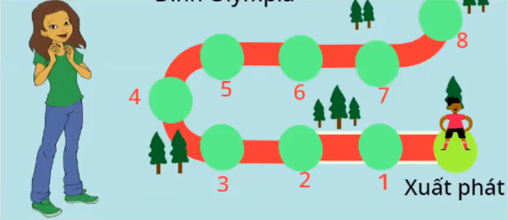

# Đề thi Bảng A - Quận Cẩm Lệ 2022

Hội thi Tin học trẻ quận Cẩm Lệ (TP Đà Nẵng), năm 2022, Bảng A (Tiểu học). Đề gồm 3 bài, tổng **10 điểm**; bài 3 yêu cầu viết chương trình **Scratch**.

!!! warning "Nguồn đề"
    Đề được chép từ 4 ảnh chụp màn hình buổi học trực tuyến (file `DaNang_CamLe_thiquan_2022.docx` trong `data/new_pdfs/DA NANG/CẨM LỆ/`), trong đó có mở file đề gốc *Camle_2022 Bang A.pdf* (2 trang). Ảnh chụp không thấy phần đầu trang 1 (tiêu đề, thời gian làm bài, ngày thi) và có thể đã cắt mất phần cuối bài 3. Đề không ghi ràng buộc dữ liệu. Ví dụ ghi "(bổ sung)" do nhóm biên soạn thêm, **không phải đề gốc**. Hình sân chơi ở bài 3 được cắt từ ảnh chụp màn hình.

## Tổng quan bài thi

| STT | Bài | Chủ đề | Điểm |
| ---: | --- | --- | ---: |
| 1 | Đếm kí tự số | Xử lý chuỗi | 3 |
| 2 | Đổi quà | Vòng lặp, cộng dồn | 3 |
| 3 | Chinh phục đỉnh Olympia | Thiết kế trò chơi Scratch | 4 |

---

## 1. Đếm kí tự số

Trong giờ thực hành môn Tin học, Sơn gõ một chuỗi ký tự bất kỳ và trong chuỗi có chứa các ký tự là chữ số. Sơn đố Hoa trả lời chính xác có bao nhiêu ký tự là chữ số xuất hiện trong chuỗi Sơn vừa nhập. Do chuỗi ký tự quá dài nên Hoa rất lo lắng, bạn hãy giúp Hoa nhé!

### Dữ liệu

* **Nhập vào:** Một chuỗi kí tự S.

### Kết quả

* **Đọc ra:** Một số duy nhất là số lượng kí tự là chữ số.

### Ví dụ

#### Nhập vào

```
Chao2mung0hoi2thitinhoc2quanCamLe
```

#### Đọc ra

```
4
```

#### Giải thích

* Trong chuỗi ký tự Sơn nhập vào có 4 kí tự chữ số là: "2" "0" "2" "2".

---

## 2. Đổi quà

Nhằm khuyến khích các bạn học sinh đọc sách, nhà sách Cẩm Lệ có chương trình khuyến mãi ***"mua sách tích lũy điểm để đổi quà"***. Theo đó, học sinh khi mua sách được tích lũy điểm bằng cách như sau: ***Mua lần thứ nhất được tính 1 điểm, mua lần thứ hai được tính 2 điểm, mua lần thứ ba được tính 3 điểm …, cứ như thế nếu mua đến lần thứ n thì được tính n điểm.*** Điều kiện được đổi quà là tổng số điểm học sinh tích lũy sau nhiều lần mua phải lớn hơn hoặc bằng **k** điểm do nhà sách qui định.

Sơn rất thích thú với chương trình khuyến mãi này và muốn biết lần mua thứ **n** và tổng số điểm tích lũy được tới lần mua đó để đủ điều kiện đổi quà của lần đầu tiên. Bạn hãy giúp Sơn nhé!

### Dữ liệu

* **Nhập vào:** Số nguyên k là số điểm giới hạn để đổi quà do nhà sách qui định.

### Kết quả

* **Đọc ra:** Cách nhau 3 giây
    * Lần 1: Số nguyên n.
    * Lần 2: Tổng số điểm tích lũy được đến lần mua thứ n.

### Ví dụ 1

#### Nhập vào

```
10
```

#### Đọc ra

```
4
10
```

#### Giải thích

* Đến lần mua thứ 4 thì Sơn có tổng số điểm tích lũy là 10 điểm và đủ để đổi quà.

### Ví dụ 2 (bổ sung)

#### Nhập vào

```
4
```

#### Đọc ra

```
3
6
```

#### Giải thích

* Sau lần mua thứ 2 mới có $1 + 2 = 3 < 4$ điểm; đến lần thứ 3 có $1 + 2 + 3 = 6 \ge 4$ điểm.

!!! note "Cách hiểu đề dùng cho lời giải tham khảo"
    "Đọc ra cách nhau 3 giây" là cách nói của Scratch: nhân vật nói số n trong 3 giây, rồi nói tổng điểm. Lời giải Python in hai số trên hai dòng. Đề không ghi giới hạn của k; lời giải giả định $k \ge 1$.

---

## 3. Chinh phục đỉnh Olympia

Viết chương trình Scratch mô phỏng trò chơi Chinh phục đỉnh Olympia như sau:



Chương trình có 2 nhân vật chính là cô giáo Hoa và học sinh Sơn. Nền trò chơi học sinh thiết kế theo mẫu (*tuy nhiên nếu học sinh thiết kế theo mẫu riêng thì phải có đủ 10 ô tròn như hình trên để học sinh nhảy đến khi trả lời đúng câu hỏi*).

Khi chơi, cô Hoa sẽ đưa ra câu hỏi là phép tính cộng hai số ngẫu nhiên trong phạm vi 10, ví dụ: **7 + 2 = ?** Bên dưới sẽ có ô trả lời để học sinh nhập vào đáp án. Nếu trả lời đúng, học sinh Sơn sẽ nhảy qua kế tiếp, bắt đầu từ **Xuất phát** qua ô số 1, số 2,…. Nếu trả lời sai thì học sinh đứng yên tại chỗ. Trò chơi dừng lại sau 01 phút.

!!! info "Có thể thiếu phần cuối đề"
    Ảnh chụp màn hình dừng ở câu "Trò chơi dừng lại sau 01 phút." và hình sân chơi bị cắt phần trên (chỉ thấy ô Xuất phát và các ô 1–8). Nếu đề gốc còn yêu cầu hay thang điểm chi tiết phía sau thì nguồn hiện có không ghi lại.

---

!!! tip "Đáp án"
    Tự làm trước, sau đó xem [lời giải tham khảo](dap-an.md).
