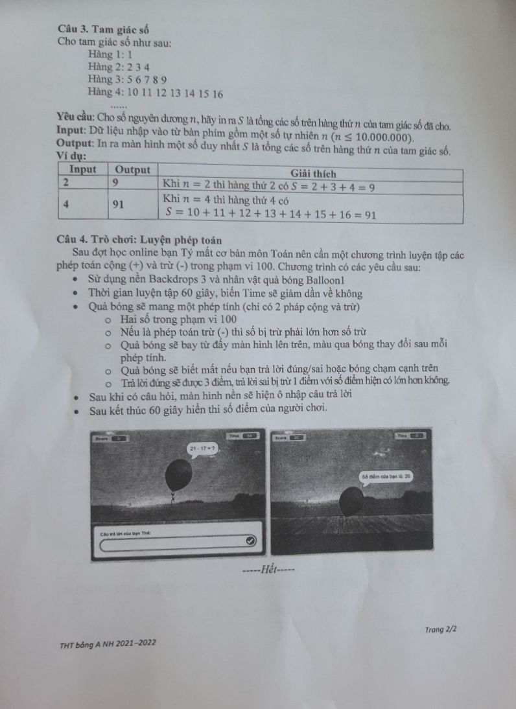

# Đề thi Bảng A - TP Đà Nẵng 2022

Hội thi Tin học trẻ TP Đà Nẵng, năm học 2021–2022, đề thi Bảng A - Khối Tiểu học (đề chính thức, đề thi có 2 trang). Thời gian làm bài: **90 phút** (không kể thời gian giao đề), ngôn ngữ **Scratch hoặc Python**.

Theo đề gốc, các bài lập trình nhập dữ liệu **từ bàn phím** và in kết quả **ra màn hình**.

!!! warning "Nguồn đề"
    Đề được chép từ 2 ảnh scan đề thi *ĐÀ NẴNG 2022 (1).jpg* và *ĐÀ NẴNG 2022 (2).jpg* (thư mục `data/new_pdfs/DA NANG/TP ĐÀ NẴNG/`). Bản scan trang 1 có bút đỏ sửa đáp án ví dụ của Câu 1 và Câu 2 (xem các ghi chú "Đính chính trên bản scan"). Đề không ghi ngày thi.

## Tổng quan bài thi

| STT | Tên bài | File chương trình | Thời gian chạy | Điểm |
| ---: | --- | --- | --- | ---: |
| 1 | Tổng dãy số | `Bai1.*` | 5 giây | 25 |
| 2 | Đếm số ký tự | `Bai2.*` | 5 giây | 25 |
| 3 | Tam giác số | `Bai3.*` | 5 giây | 25 |
| 4 | Luyện phép toán | `Bai4.*` | 1 phút | 25 |

*Chú ý: Dấu \* có thể là sb2/sb3 hoặc py tương ứng với ngôn ngữ lập trình là Scratch hoặc Python.*

---

## 1. Tổng dãy số

Cho 2 số nguyên dương $n, k$. Hãy tính tổng $S$ là các số chia hết cho $k$ trong đoạn từ 1 đến $n$.

Ví dụ: $n = 20, k = 5$ thì tổng $S = 5 + 10 + 15 + 20 = 50$.

**Yêu cầu:** Cho 2 số nguyên dương $n, k$, hãy tìm và in ra giá trị $S$.

!!! note "Đính chính trên bản scan"
    Bản in ghi $S = 5 + 10 + 15 + 20 = 40$; trên bản scan có bút đỏ gạch số 40 và sửa thành **50**. Bản sửa đúng: $5 + 10 + 15 + 20 = 50$ (khớp với lời giải đã chạy).

### Dữ liệu

Nhập vào từ bàn phím gồm hai dòng:

* Dòng thứ nhất chứa số tự nhiên $n$ ($n \le 1.000.000.000$).
* Dòng thứ hai chứa số tự nhiên $k$ ($k \le 10$).

### Kết quả

In ra màn hình một số $S$ duy nhất là tổng các số chia hết cho $k$ trong đoạn từ $L$ đến $R$.

!!! note "Cách hiểu đề dùng cho lời giải tham khảo"
    Mục Output của đề gốc ghi "trong đoạn từ $L$ đến $R$", nhưng đề không có $L, R$. Lời giải hiểu là đoạn từ 1 đến $n$, đúng như phần mô tả và các ví dụ.

### Ví dụ

| Input | Output | Giải thích |
| --- | --- | --- |
| `20`<br>`3` | `63` | Tổng $S = 3 + 6 + 9 + 12 + 15 + 18 = 63$ |
| `14`<br>`2` | `56` | Tổng $S = 2 + 4 + 6 + 8 + 10 + 12 + 14 = 56$ |

---

## 2. Đếm số ký tự

Bạn viết dòng chữ "HOI THI TIN HOC TRE CAP THANH PHO" lặp lại nhiều lần thành dãy ký tự liên tiếp như sau:

```
HOITHITINHOCTRECAPTHANHPHOHOITHITINHOCTRECAPTHANHPHOHOITHITIN …
```

**Yêu cầu:** Cho số tự nhiên $n$ và ký tự $ch$ in hoa bất kỳ, đếm xem từ ký tự thứ nhất đến ký tự thứ $n$ có bao nhiêu ký tự $ch$.

Ví dụ: $n = 40$, $ch = $ 'O', trong 40 ký tự đầu tiên của dãy có 4 ký tự 'O' (đề gốc gạch chân các chữ O trong dãy).

### Dữ liệu

Nhập vào từ bàn phím gồm hai dòng:

* Dòng thứ nhất chứa số tự nhiên $n$ ($n \le 10.000.000$).
* Dòng thứ hai chứa ký tự $ch$ (ký tự in hoa).

### Kết quả

In ra màn hình một số duy nhất là số lượng ký tự $ch$ trong $n$ ký tự đầu tiên của dãy ký tự.

### Ví dụ

| Input | Output | Giải thích |
| --- | --- | --- |
| `40`<br>`O` | `5` | `HOITHITINHOCTRECAPTHANHPHOHOITHITINHOCTR` (đề gốc gạch chân các chữ O) |
| `30`<br>`L` | `0` | Trong dãy ký tự không chứa ký tự 'L' nào |

!!! note "Đính chính trên bản scan"
    Bảng ví dụ bản in ghi Output của ví dụ 1 là **4**; trên bản scan có bút đỏ gạch và sửa thành **5**. Bản sửa đúng: 40 ký tự đầu là `HOITHITINHOCTRECAPTHANHPHO` (26 ký tự, có 3 chữ O) + `HOITHITINHOCTR` (14 ký tự, có 2 chữ O), tổng **5** chữ O, khớp với lời giải đã chạy. Câu "trong 40 ký tự đầu tiên của dãy có 4 ký tự 'O'" ở phần mô tả không được sửa trên bản scan nhưng cũng sai, đúng phải là 5.

---

## 3. Tam giác số

Cho tam giác số như sau:

```
Hàng 1: 1
Hàng 2: 2 3 4
Hàng 3: 5 6 7 8 9
Hàng 4: 10 11 12 13 14 15 16
……
```

**Yêu cầu:** Cho số nguyên dương $n$, hãy in ra $S$ là tổng các số trên hàng thứ $n$ của tam giác số đã cho.

### Dữ liệu

Nhập vào từ bàn phím gồm một số tự nhiên $n$ ($n \le 10.000.000$).

### Kết quả

In ra màn hình một số duy nhất $S$ là tổng các số trên hàng thứ $n$ của tam giác số.

### Ví dụ

| Input | Output | Giải thích |
| --- | --- | --- |
| `2` | `9` | Khi $n = 2$ thì hàng thứ 2 có $S = 2 + 3 + 4 = 9$ |
| `4` | `91` | Khi $n = 4$ thì hàng thứ 4 có $S = 10 + 11 + 12 + 13 + 14 + 15 + 16 = 91$ |

---

## 4. Trò chơi: Luyện phép toán

Sau đợt học online bạn Tý mất cơ bản môn Toán nên cần một chương trình luyện tập các phép toán cộng (+) và trừ (-) trong phạm vi 100. Chương trình có các yêu cầu sau:

- Sử dụng nền Backdrops 3 và nhân vật quả bóng Balloon1.
- Thời gian luyện tập 60 giây, biến Time sẽ giảm dần về không.
- Quả bóng sẽ mang một phép tính (chỉ có 2 phép cộng và trừ):
    - Hai số trong phạm vi 100.
    - Nếu là phép toán trừ (-) thì số bị trừ phải lớn hơn số trừ.
    - Quả bóng sẽ bay từ đáy màn hình lên trên, màu quả bóng thay đổi sau mỗi phép tính.
    - Quả bóng sẽ biến mất nếu bạn trả lời đúng/sai hoặc bóng chạm cạnh trên.
    - Trả lời đúng sẽ được 3 điểm, trả lời sai bị trừ 1 điểm với số điểm hiện có lớn hơn không.
- Sau khi có câu hỏi, màn hình nền sẽ hiện ô nhập câu trả lời.
- Sau kết thúc 60 giây hiển thị số điểm của người chơi.

Xem hình minh họa màn hình trò chơi trong [bản scan](#de-goc-ban-scan).

!!! note "Chính tả"
    Bản in có vài lỗi gõ ("2 pháp cộng", "bay từ đẩy màn hình", "màu qua bóng", "biết mất"); trang này chép lại theo nghĩa rõ ràng: "2 phép cộng", "bay từ đáy màn hình", "màu quả bóng", "biến mất".

---

## Đề gốc (bản scan) { #de-goc-ban-scan }

Trang 2 của đề (hình minh họa Câu 4):



---

!!! tip "Đáp án"
    Tự làm trước, sau đó xem [lời giải tham khảo](dap-an.md).
