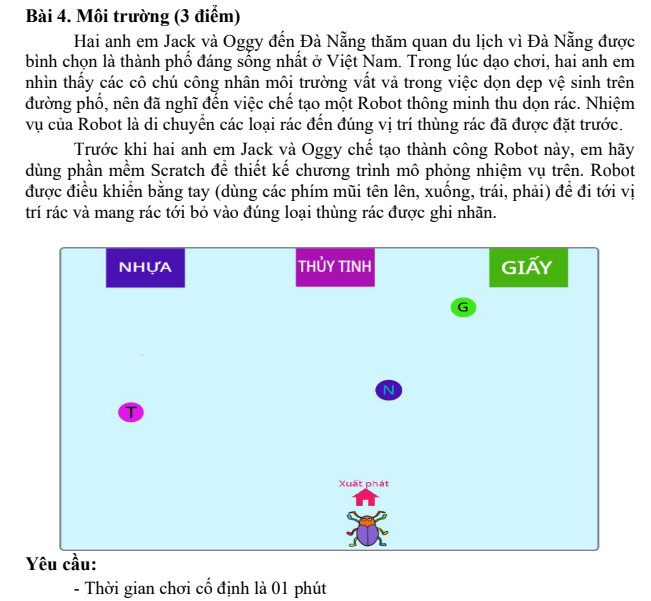

# Đề thi Bảng A - Quận Thanh Khê 2022

Hội thi Tin học trẻ cấp quận, quận Thanh Khê (TP. Đà Nẵng), năm học 2021–2022. Đề thi Bảng A - Khối Tiểu học. Thời gian: **120 phút** (không kể thời gian giao đề). Công cụ: **Scratch** (tệp `.sb3`).

!!! warning "Nguồn đề"
    Đề được chép từ ảnh chụp đề thi (`data/new_pdfs/DA NANG/THANH KHÊ/THANH KHÊ 2022 (1).png` đến `(4).png`). Ảnh không ghi ngày thi; đề không ghi cách nhập/xuất cụ thể ngoài "nhập vào", "in ra (màn hình)". Ảnh cuối bị cắt ngang mục "Yêu cầu" của Bài 4, phần còn lại của Bài 4 không có trong nguồn. Hình minh họa Bài 4 xem trong [bản scan](#de-goc-ban-scan).

## Tổng quan bài thi

| STT | Bài | File chương trình | Điểm |
| ---: | --- | --- | ---: |
| 1 | Chia quà | `Chiaqua.sb3` | 2.0 |
| 2 | Tổng 3K | `Tong3k.sb3` | 2.5 |
| 3 | Màu chữ | `Mauchu.sb3` | 2.5 |
| 4 | Môi trường | `Moitruong.sb3` | 3.0 |

---

## 1. Chia quà

*(2.0 điểm)*

Jack mua N cuốn sách và muốn chia đều cho M người bạn thân. Em hãy giúp Jack biết cần mua thêm ít nhất bao nhiêu cuốn sách nữa để có thể thực hiện được việc chia quà cho các bạn của mình đều nhau?

**Yêu cầu:** Nhập vào số $N$ và $M$ $(0 < N, M < 10^{12})$, in ra giá trị một số nguyên dương duy nhất là số sách **ít nhất** mà Jack cần bổ sung (nếu đủ ghi 0).

### Ví dụ 1

#### Nhập vào

```
20
5
```

#### In ra

```
0
```

#### Giải thích

* Jack có 20 cuốn sách và chia cho 5 người bạn, mỗi người sẽ có 4 cuốn đều nhau

### Ví dụ 2

#### Nhập vào

```
30
8
```

#### In ra

```
2
```

#### Giải thích

* Jack có 30 cuốn sách và chia cho 8 người bạn, để mỗi người có số sách đều nhau thì Jack phải mua thêm ít nhất 2 cuốn.

---

## 2. Tổng 3K

*(2.5 điểm)*

Cho dãy số có dạng như sau: 11, 14, 17,. .., 68….

Jack đố Oggy khi nhập vào một số $k$ $(k > 0)$ bất kỳ thì Oggy trả lời đúng tổng các số hạng thứ k, k + 1 và k + 2 của dãy số trên.

### Ví dụ

#### Nhập vào

```
3
```

#### In ra

```
60
```

#### Giải thích

* 11, 14, **17**, **20**, **23**,. .., 68….
* Số thứ k = 3: **17**
* Số thứ k + 1 = 4: **20**
* Số thứ k + 2 = 5: **23**
* Tổng: 17 + 20 + 23 = **60**

### Giới hạn

* Có 60% test tương ứng 50% số điểm của bài với $1 \le k < 100$;
* Có 40% test khác tương ứng với 40% số điểm còn lại của bài với $k < 10^{12}$;

!!! note "Cách hiểu đề dùng cho lời giải tham khảo"
    Phần "Giới hạn" của đề gốc ghi tỉ lệ điểm 50% + 40% (không đủ 100%), có thể là lỗi in. Lời giải tham khảo xử lý được mọi $k$ đến $10^{12}$ nên không phụ thuộc vào cách chia điểm.

---

## 3. Màu chữ

*(2.5 điểm)*

Jack viết dòng chữ **TIN HOC TRE THANH KHE** lặp lại nhiều lần thành dãy các kí tự liên tiếp như sau:

```
TINHOCTRETHANHKHETINHOCTRETHANHKHETIN…..
```

Sau đó Jack tô màu các chữ cái trong dãy theo thứ tự Blue, Red, White, Yellow, Blue, Red, White, Yellow,...

**Yêu cầu:** Nhập vào số nguyên dương $k$ $(k \ge 1)$, hãy in ra màn hình chữ cái thứ k và màu của kí tự đó trong dãy theo định dạng: **Kí tự - Màu**

### Ví dụ 1

#### Nhập vào

```
5
```

#### In ra

```
O-Blue
```

### Ví dụ 2

#### Nhập vào

```
23
```

#### In ra

```
C-White
```

#### Giải thích

* Dãy: `TINHOCTRETHANHKHETINHOCTRETHANHKHE…`
* Chữ thứ 5 là `O`, màu thứ 5 trong chu kỳ Blue, Red, White, Yellow là Blue.
* Chữ thứ 23 là `C` (chữ thứ 6 của lần lặp thứ hai), màu thứ 23 là White.

### Giới hạn

* Có 60% test tương ứng 60% số điểm của bài với $1 \le k < 100$;
* Có 40% test khác tương ứng với 40% số điểm còn lại của bài với $k < 10^{12}$;

!!! note "Cách hiểu đề dùng cho lời giải tham khảo"
    Bảng ví dụ của đề gốc chỉ chép lại dãy chữ ở cột "Giải thích"; hai dòng giải thích chi tiết ở trên do nhóm biên soạn viết thêm. Định dạng in ra theo ví dụ của đề: kí tự, dấu `-`, tên màu, không có dấu cách.

---

## 4. Môi trường

*(3 điểm)*

Hai anh em Jack và Oggy đến Đà Nẵng thăm quan du lịch vì Đà Nẵng được bình chọn là thành phố đáng sống nhất ở Việt Nam. Trong lúc dạo chơi, hai anh em nhìn thấy các cô chú công nhân môi trường vất vả trong việc dọn dẹp vệ sinh trên đường phố, nên đã nghĩ đến việc chế tạo một Robot thông minh thu dọn rác. Nhiệm vụ của Robot là di chuyển các loại rác đến đúng vị trí thùng rác đã được đặt trước.

Trước khi hai anh em Jack và Oggy chế tạo thành công Robot này, em hãy dùng phần mềm Scratch để thiết kế chương trình mô phỏng nhiệm vụ trên. Robot được điều khiển bằng tay (dùng các phím mũi tên lên, xuống, trái, phải) để đi tới vị trí rác và mang rác tới bỏ vào đúng loại thùng rác được ghi nhãn.

Hình minh họa (xem [bản scan](#de-goc-ban-scan)): sân khấu có ba thùng rác ghi nhãn **NHỰA**, **THỦY TINH**, **GIẤY** ở phía trên; các quả rác ghi chữ **G**, **N**, **T**; Robot (con bọ) đứng ở vị trí **Xuất phát** phía dưới.

**Yêu cầu:**

- Thời gian chơi cố định là 01 phút
- [không có trong nguồn - ảnh bị cắt]

!!! info "Thiếu đề chi tiết"
    Ảnh chụp đề bị cắt sau dòng đầu tiên của mục "Yêu cầu", nên chưa có đủ các yêu cầu còn lại của Bài 4 (cách tính điểm, điều kiện kết thúc...). Nếu bạn có đề gốc, hãy gửi qua issue trên GitHub.

---

!!! tip "Đáp án"
    Tự làm trước, sau đó xem [lời giải tham khảo](dap-an.md).

## Đề gốc (bản scan) { #de-goc-ban-scan }


