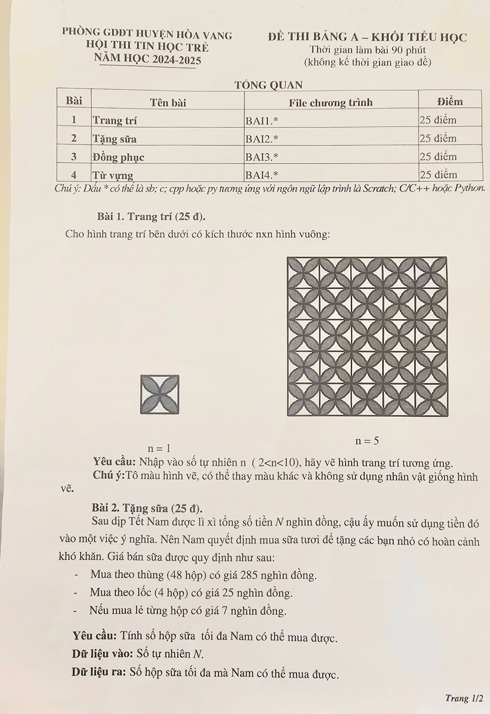

# Đề thi Bảng A - Huyện Hòa Vang 2025

Hội thi Tin học trẻ, Phòng GDĐT huyện Hòa Vang (TP. Đà Nẵng), năm học 2024–2025. Đề thi Bảng A - Khối Tiểu học. Thời gian làm bài: **90 phút** (không kể thời gian giao đề).

Ngôn ngữ: Scratch, C/C++ hoặc Python. Tên file chương trình `BAIx.*`, trong đó dấu `*` là `sb`, `c`, `cpp` hoặc `py` tương ứng với ngôn ngữ lập trình là Scratch, C/C++ hoặc Python. Đề không ghi cách nhập/xuất bằng file (Bài 4 ghi "nhập từ bàn phím").

!!! warning "Nguồn đề"
    Đề được chép từ ảnh chụp đề thi gồm 2 trang *HÒA VANG/HÒA VANG 2025 (1).jpg* và *HÒA VANG/HÒA VANG 2025 (2).jpg* (bộ đề Đà Nẵng). Đề không ghi ngày thi và không ghi giới hạn của $N$ ở Bài 2, 3, 4.

## Tổng quan bài thi

| STT | Bài | File chương trình | Điểm |
| ---: | --- | --- | ---: |
| 1 | Trang trí | `BAI1.*` | 25 |
| 2 | Tặng sữa | `BAI2.*` | 25 |
| 3 | Đồng phục | `BAI3.*` | 25 |
| 4 | Từ vựng | `BAI4.*` | 25 |

---

## 1. Trang trí

Cho hình trang trí bên dưới có kích thước nxn hình vuông:

Xem hình mẫu với $n = 1$ và $n = 5$ trong [bản scan](#de-goc-ban-scan): với $n = 1$ là một ô vuông có 4 cánh hoa hình lá xếp theo hai đường chéo; với $n = 5$ là lưới $5 \times 5$ ô như vậy ghép liền nhau.

**Yêu cầu:** Nhập vào số tự nhiên n ($2 < n < 10$), hãy vẽ hình trang trí tương ứng.

**Chú ý:** Tô màu hình vẽ, có thể thay màu khác và không sử dụng nhân vật giống hình vẽ.

!!! note "Cách hiểu đề dùng cho gợi ý"
    Hình $n = 1$ trong đề chỉ để minh họa một ô hoa văn; giá trị nhập vào theo đề là $2 < n < 10$.

---

## 2. Tặng sữa

Sau dịp Tết Nam được lì xì tổng số tiền $N$ nghìn đồng, cậu ấy muốn sử dụng tiền đó vào một việc ý nghĩa. Nên Nam quyết định mua sữa tươi để tặng các bạn nhỏ có hoàn cảnh khó khăn. Giá bán sữa được quy định như sau:

- Mua theo thùng (48 hộp) có giá 285 nghìn đồng.
- Mua theo lốc (4 hộp) có giá 25 nghìn đồng.
- Nếu mua lẻ từng hộp có giá 7 nghìn đồng.

**Yêu cầu:** Tính số hộp sữa tối đa Nam có thể mua được.

### Dữ liệu

* Số tự nhiên $N$.

### Kết quả

* Số hộp sữa tối đa mà Nam có thể mua được.

### Ví dụ 1

#### Nhập vào

```
285
```

#### In ra

```
48
```

#### Giải thích

* Nam mua 1 thùng 48 hộp giá 285 nghìn.

### Ví dụ 2

#### Nhập vào

```
318
```

#### In ra

```
53
```

#### Giải thích

* Nam mua 1 thùng (48 hộp) hết 285 nghìn, 1 lốc (4 hộp) hết 25 nghìn và 1 hộp lẻ hết 7 nghìn. Tổng được 53 hộp.

---

## 3. Đồng phục

Trường Tèo chuẩn bị tham gia múa dân vũ, nhà trường tiến hành đặt may đồng phục áo cho các bạn với 3 kích cỡ: S, M, L. Lượng vải cần thiết để may mỗi áo kích cỡ S, M, L lần lượt là 2, 3, 4 mét vải. Để tính toán được lượng vải cần mua, Tèo lần lượt viết chuỗi ký tự gồm các chữ cái S, M, L tương ứng cho $N$ học sinh.

**Yêu cầu:** Tính số lượng mét vải cần sử dụng.

### Dữ liệu

* Dòng thứ nhất: Số tự nhiên $N$ là số học sinh.
* Dòng thứ hai: Chuỗi có $N$ ký tự bao gồm các chữ cái S, M, L tương ứng cho $N$ học sinh.

### Kết quả

* Số lượng mét vải cần sử dụng.

### Ví dụ

#### Nhập vào

```
3
LMS
```

#### In ra

```
9
```

#### Giải thích

* 1 áo kích thước S (2 mét), 1 áo kích thước M (3 mét), 1 áo kích thước L (4 mét). Vậy cần sử dụng 9 mét vải.

---

## 4. Từ vựng

Tí muốn nâng cao vốn từ vựng Tiếng Anh của mình để đạt danh hiệu "Trạng Nguyên Tiếng Anh". Cậu ấy lập kế hoạch học từ vựng mỗi ngày trong tuần như sau:

- Vào ngày thứ $K$ trong tuần (với $2 \le K \le 7$) nhớ được $K$ từ mới.
- Riêng Chủ nhật, Tí sẽ dành thời gian nghỉ ngơi và tham gia các hoạt động ngoài trời.

Hôm nay là Thứ $K$ (nhập từ bàn phím 0, 2, 3, ..., 7 tương ứng với Chủ Nhật, Thứ Hai, Thứ Ba, ..., Thứ Bảy), ngày mai là ngày đầu tiên Tí thực hiện kế hoạch đã đặt ra.

**Yêu cầu:** Tính sau $N$ ngày Tí sẽ nhớ được bao nhiêu từ vựng.

### Dữ liệu

* Dòng thứ nhất: Số tự nhiên $K$ (0, 2, 3, ..., 7 tương ứng với Chủ Nhật, Thứ Hai, Thứ Ba, ..., Thứ Bảy).
* Dòng thứ hai: Số tự nhiên $N$.

### Kết quả

* Số từ mới Tí học được sau $N$ ngày.

### Ví dụ 1

#### Nhập vào

```
0
4
```

#### In ra

```
14
```

#### Giải thích

* Số từ mới Tí nhớ được trong 4 ngày đầu tiên lần lượt là: 2, 3, 4, 5. Vậy Tí đã nhớ được tất cả là 14 từ mới.

### Ví dụ 2

#### Nhập vào

```
2
8
```

#### In ra

```
30
```

#### Giải thích

* Số từ mới Tí nhớ được trong 8 ngày đầu tiên lần lượt là: 3, 4, 5, 6, 7, 0, 2, 3. Vậy Tí đã nhớ được 30 từ mới.

---

## Đề gốc (bản scan) { #de-goc-ban-scan }

Trang 1 (có hình mẫu của Bài 1):



---

!!! tip "Đáp án"
    Tự làm trước, sau đó xem [lời giải tham khảo](dap-an.md).
