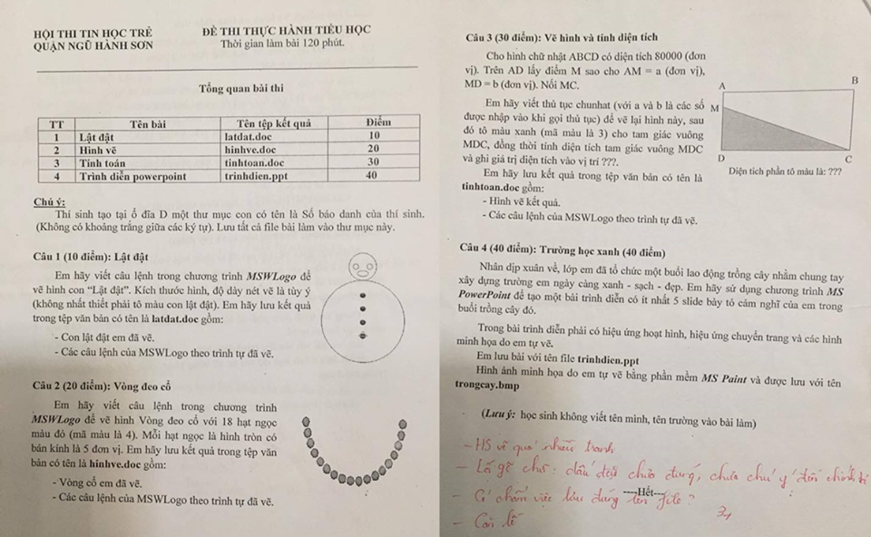

# Đề thi Bảng A - Quận Ngũ Hành Sơn (chưa rõ năm)

Hội thi Tin học trẻ quận Ngũ Hành Sơn, đề thi thực hành Tiểu học. Thời gian làm bài: **120 phút**.

Phần mềm sử dụng: **MSWLogo**, **Microsoft Word** (lưu bài dạng `.doc`), **Microsoft PowerPoint** và **MS Paint**.

!!! warning "Nguồn đề"
    Đề được chép từ ảnh chụp đề thi (`DA NANG/NGŨ HÀNH SƠN/NGŨ HÀNH SƠN.png`). Ảnh chụp 2 trang đặt cạnh nhau, mép trái trang 1 bị cắt một ít nhưng vẫn đọc được nội dung. Bút đỏ cuối trang 2 là nhận xét chấm bài của giáo viên, không thuộc đề. Đây là đề thực hành ứng dụng (vẽ MSWLogo, soạn văn bản, trình chiếu), không có bài lập trình giải thuật nên không có lời giải Python/C++. Hình mẫu xem trong [bản scan](#de-goc-ban-scan).

!!! note "Năm thi chưa xác định"
    Ảnh không ghi năm học hay ngày thi, và nhóm biên soạn chưa tìm thấy đề này trên mạng. **Ước tính** (chưa xác nhận): hình thức thi MSWLogo + Word/PowerPoint, 120 phút giống các đề Đà Nẵng 2015–2018 trên site, còn từ 2019 các đề Đà Nẵng trên site đều thi Scratch, nên nhiều khả năng đề thuộc giai đoạn trước 2019. Đề này khác đề [Ngũ Hành Sơn 2017](../../2017/nhs2017-de1/index.md). Nếu bạn biết năm thi, hãy gửi qua issue trên GitHub.

## Tổng quan bài thi

| TT | Tên bài | Tên tệp kết quả | Điểm |
| ---: | --- | --- | ---: |
| 1 | Lật đật | `latdat.doc` | 10 |
| 2 | Hình vẽ | `hinhve.doc` | 20 |
| 3 | Tính toán | `tinhtoan.doc` | 30 |
| 4 | Trình diễn powerpoint | `trinhdien.ppt` | 40 |

**Chú ý:** Thí sinh tạo tại ổ đĩa D một thư mục con có tên là Số báo danh của thí sinh. (Không có khoảng trắng giữa các ký tự). Lưu tất cả file bài làm vào thư mục này.

!!! note "Tên bài trong bảng và trong đề"
    Bảng tổng quan ghi tên bài 2, 3, 4 là "Hình vẽ", "Tính toán", "Trình diễn powerpoint", còn phần đề ghi "Vòng đeo cổ", "Vẽ hình và tính diện tích", "Trường học xanh". Bên dưới dùng tên trong phần đề.

---

## 1. Lật đật

**Câu 1 (10 điểm)**

Em hãy viết câu lệnh trong chương trình *MSWLogo* để vẽ hình con "Lật đật". Kích thước hình, độ dày nét vẽ là tùy ý (không nhất thiết phải tô màu con lật đật). Em hãy lưu kết quả trong tệp văn bản có tên là **latdat.doc** gồm:

* Con lật đật em đã vẽ.
* Các câu lệnh của MSWLogo theo trình tự đã vẽ.

Hình mẫu: một hình tròn nhỏ (đầu, có hai mắt và miệng) đặt trên một hình tròn lớn (thân, có các nút tròn nhỏ dọc giữa thân). Xem trong [bản scan](#de-goc-ban-scan).

---

## 2. Vòng đeo cổ

**Câu 2 (20 điểm)**

Em hãy viết câu lệnh trong chương trình *MSWLogo* để vẽ hình Vòng đeo cổ với 18 hạt ngọc màu đỏ (mã màu là 4). Mỗi hạt ngọc là hình tròn có bán kính là 5 đơn vị. Em hãy lưu kết quả trong tệp văn bản có tên là **hinhve.doc** gồm:

* Vòng cổ em đã vẽ.
* Các câu lệnh của MSWLogo theo trình tự đã vẽ.

Hình mẫu: các hạt ngọc xếp sát nhau theo hình chữ U (nửa dưới một đường cong). Xem trong [bản scan](#de-goc-ban-scan).

---

## 3. Vẽ hình và tính diện tích

**Câu 3 (30 điểm)**

Cho hình chữ nhật ABCD có diện tích 80000 (đơn vị). Trên AD lấy điểm M sao cho AM = a (đơn vị), MD = b (đơn vị). Nối MC.

Em hãy viết thủ tục chunhat (với a và b là các số được nhập vào khi gọi thủ tục) để vẽ lại hình này, sau đó tô màu xanh (mã màu là 3) cho tam giác vuông MDC, đồng thời tính diện tích tam giác vuông MDC và ghi giá trị diện tích vào vị trí ???.

Em hãy lưu kết quả trong tệp văn bản có tên là **tinhtoan.doc** gồm:

* Hình vẽ kết quả.
* Các câu lệnh của MSWLogo theo trình tự đã vẽ.

Hình mẫu: hình chữ nhật ABCD (A trên trái, B trên phải, C dưới phải, D dưới trái), M nằm trên cạnh AD, tam giác MDC được tô màu; bên dưới hình ghi "Diện tích phần tô màu là: ???". Xem trong [bản scan](#de-goc-ban-scan).

---

## 4. Trường học xanh

**Câu 4 (40 điểm)**

Nhân dịp xuân về, lớp em đã tổ chức một buổi lao động trồng cây nhằm chung tay xây dựng trường em ngày càng xanh - sạch - đẹp. Em hãy sử dụng chương trình *MS PowerPoint* để tạo một bài trình diễn có ít nhất 5 slide bày tỏ cảm nghĩ của em trong buổi trồng cây đó.

Trong bài trình diễn phải có hiệu ứng hoạt hình, hiệu ứng chuyển trang và các hình minh họa do em tự vẽ.

Em lưu bài với tên file **trinhdien.ppt**

Hình ảnh minh họa do em tự vẽ bằng phần mềm *MS Paint* và được lưu với tên **trongcay.bmp**

*(Lưu ý: học sinh không viết tên mình, tên trường vào bài làm)*

---

## Đề gốc (bản scan) { #de-goc-ban-scan }

---

!!! tip "Đáp án"
    Tự làm trước, sau đó xem [gợi ý hướng làm](dap-an.md).
